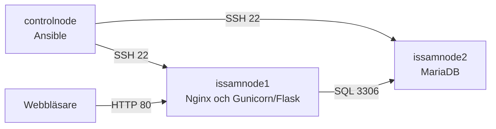
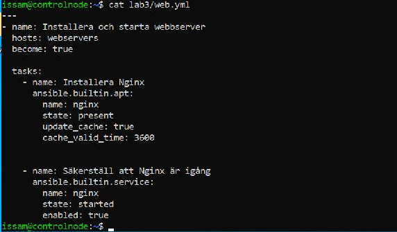
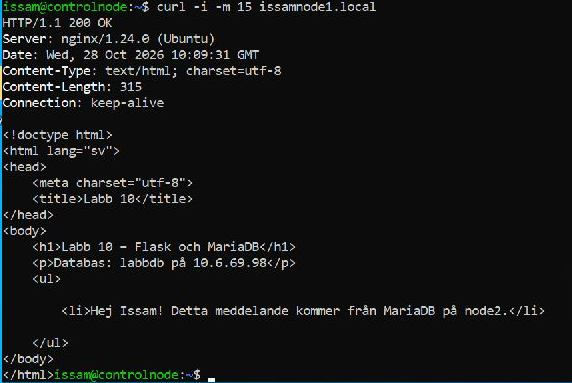

# Configuration Management – samlat automationsprojekt 

Här samlade jag ihop det vi gjort i labbarna och gick igenom VG-kraven.
Fick ordning på filerna som saknades, körinstruktionerna och beskrivningen
av hur miljön hänger ihop. Labbarna ligger kvar i egna mappar med kod,
rapporter och bilder. Det här är slutsammanställningen för Lab 12.

Miljön består av controlnode och två Ubuntu-noder i Hyper-V. Den färdiga
applikationen från Lab 10 använder Nginx, Gunicorn och Flask på node1 och
MariaDB på node2.

Arkitekturmotiveringen finns i [ARCHITECTURE.md](ARCHITECTURE.md).
Den följer lärarens fyra områden och är cirka 780 ord, inom kravet på
500–1000 ord. Förutsättningarna, körkommandona och kontrollerna finns nedan.

## Struktur och redovisningar

Varje labb har sin egen mapp med kod, rapport och eventuella skärmbilder.
Roller finns intill respektive huvud-playbook. Mallar ligger under
roles/rollnamn/templates eller, i Lab 8, templates/. Känsliga variabler
för Lab 7 och 10 ligger Vault-krypterade i respektive group_vars/all/.

| Lab | Innehåll | Redovisning |
| --- | --- | --- |
| 1 | Miljö, SSH och anslutningstest | [Rapport](labb-1/labb1.md) |
| 2 | Ad-hoc-kommandon och facts | [Rapport](labb-2/rapport-labb2.md) |
| 3 | Nginx-playbook och idempotens | [Rapport](labb-3/rapport.md) |
| 4 | Administratörskonto och SSH-nyckel | [Rapport](labb-4/rapport.md) |
| 5 | common- och webserver-roller, VG | [Rapport](labb-5/rapport.md) |
| 6 | Jinja2 och handler | [Rapport](labb-6/rapport.md) |
| 7 | Vault, databasroll och databasanvändare, VG | [Rapport](labb-7/rapport.md) |
| 8 | CMDB-underlag och beroenden, VG | [Rapport](labb-8/rapport.md) |
| 9 | Python och filbaserat dynamiskt inventory | [Rapport](labb-9/rapport.md) |
| 10 | Flask, Gunicorn/Nginx och MariaDB, VG | [Rapport](labb-10/rapport.md) |
| 11 | Jämförelse mellan Ansible och Puppet | [Rapport](labb-11/rapport.md) |

Lokala källfiler hittas relativt playbooken eller inventoryskriptet.
Sökvägar som /etc/labbapp och /opt/labbapp är avsiktliga destinationssökvägar
på målnoden. ~/.ssh/devops_admin.pub är kontrollnodens externa publika
nyckel, oberoende av vilket användarnamn eller vilken klonmapp den har.

De fyra delarna i [ARCHITECTURE.md](ARCHITECTURE.md) förklarar verktygsval,
säkerhet, skalbarhet och drift.

Lab 11 har ingen egen VG-del. [Jämförelsen mellan Ansible och Puppet](labb-11/rapport.md)
finns med som underlag för verktygsvalet.

## Så hänger miljön ihop



## Förutsättningar

Kör projektet från en Linux-kontrollnod med Ansible, Python 3 och Git.
Sammanställningen har syntaxkontrollerats med ansible-core 2.16.3 på Ubuntu.
Målnoderna använder Ubuntu Server 24.04.

Följande behöver finnas innan driftsättningen:

- SSH-åtkomst som issam till issamnode1.local och issamnode2.local.
- Fungerande namnuppslagning, i vår miljö mDNS med avahi-daemon.
- Sudo-behörighet för issam på målnoderna.
- Vault-lösenordet från Lab 7, tillgängligt utanför Git.
- Åtkomst till Ubuntu-paketkällor och PyPI från noderna vid installation.

Kontrollera adresserna i
[labb-10/lab10/group_vars/all/main.yml](labb-10/lab10/group_vars/all/main.yml)
innan körning i en annan miljö. I labbkonfigurationen är db_host
10.6.69.98 och web_host 10.6.69.99. Inventories anger användaren issam;
anpassa den om kontona heter något annat.

Repot är privat och Stefan har åtkomst, bekräftat vid sammanställningen
den 28 oktober 2026.

## Klona och installera samlingarna

Kör på kontrollnoden, med ett GitHub-konto som har läsåtkomst till repot:

```bash
git clone https://github.com/issamhariri-code/configuration-management.git Configuration-Management
cd Configuration-Management
ansible-galaxy collection install -r requirements.yml
```

[requirements.yml](requirements.yml) anger ansible.posix 1.5.4 och
community.mysql 3.16.0. Den senare används även i Lab 7 och 10.

Testa SSH-åtkomsten från repots rot:

```bash
ansible all -i labb-1/inventory.ini -m ping
```

Båda noderna ska svara med SUCCESS och pong. På en ny kontrollnod behöver
dess SSH-nyckel först vara betrodd på noderna, som i [Lab 1](labb-1/labb1.md).
Privata nycklar hålls utanför repot.

## Kör den färdiga applikationen – Lab 10

Projektkoden för Lab 10 ligger i undermappen labb-10/lab10.
Från repots rot:

```bash
cd labb-10/lab10
ansible-playbook -i inventory.ini site.yml --syntax-check
ansible all -i inventory.ini -m ping --ask-vault-pass
ansible-playbook -i inventory.ini site.yml --ask-become-pass --ask-vault-pass
```

Ange sudo-lösenordet för issam och det befintliga Vault-lösenordet vid
respektive fråga. Lösenorden skrivs inte in i källkoden.

Playbooken konfigurerar först MariaDB på node2 och sedan webbappen och Nginx
på node1. Database-rollen hanterar databastjänsten. Webbapp-rollen skapar
tjänstekontot, Python-miljön, konfigurationen, systemd-tjänsten och proxyn.

Testa därefter från kontrollnoden:

```bash
curl -i --max-time 15 http://issamnode1.local/
```

Förväntat resultat är HTTP 200 och texten:

> Hej Issam! Detta meddelande kommer från MariaDB på node2.

Sidan kan även öppnas på http://issamnode1.local/ från en dator som når
labbnätet och kan slå upp namnet. Svaret visar hela kedjan genom webbappen
till databasen.

Kör samma playbook igen för att kontrollera idempotensen:

```bash
ansible-playbook -i inventory.ini site.yml --ask-become-pass --ask-vault-pass
```

Vid en omedelbar omkörning utan ändringar förväntas changed=0, failed=0
och unreachable=0 på båda noderna. Det dokumenterade resultatet finns i
[Lab 10-rapporten](labb-10/rapport.md).

### Checkläge och felsökning

På en redan etablerad labbmiljö kan en prognos göras med:

```bash
ansible-playbook -i inventory.ini site.yml --check --ask-become-pass --ask-vault-pass
```

Checkläge ersätter inte en riktig körning eller ett HTTP-test. SQL-uppgifter
och vissa kontroller kan hoppas över. Uppgifter som bygger på filer som
ännu inte skapats kan också behöva en första riktig körning.
[Ansibles beskrivning av checkläge](https://docs.ansible.com/projects/ansible/latest/playbook_guide/playbooks_checkmode.html)

Vid fel: kontrollera först inventory och SSH, sedan syntaxen och den uppgift
som felmeddelandet pekar på. Playbooken kör nginx -t före Nginx-handlern.
Databasinställningarnas uppgift har no_log och diff: false för att skydda
hemligheter i utskrifter och diffar.

## Köra enskilda tidigare labbar

Kommandona nedan utgår från repots rot. Kör labbarna var för sig.
Lab 6 skriver en statisk Nginx-konfiguration på samma nod som Lab 10.
Kör Lab 10 sist om den färdiga Flask-applikationen ska vara det aktiva läget.

Lab 4–6 läser den publika filen ~/.ssh/devops_admin.pub från kontrollnoden.
Om det separata nyckelparet från Lab 4 saknas kan det skapas där:

```bash
ssh-keygen -t ed25519 -f ~/.ssh/devops_admin -C "devops_admin@controlnode"
```

Den privata nyckeln ska stanna utanför repot. Läs sedan in rätt
labb-inventory och playbook:

```bash
ansible-playbook -i labb-3/inventory.ini labb-3/web.yml --ask-become-pass

ansible-playbook -i labb-4/inventory.ini labb-4/users.yml --ask-become-pass

ansible-playbook -i labb-5/inventory.ini labb-5/site.yml --ask-become-pass

ansible-playbook -i labb-6/inventory.ini labb-6/site.yml --ask-become-pass

ansible-playbook -i labb-7/inventory.ini labb-7/site.yml --ask-become-pass --ask-vault-pass

ansible-playbook -i labb-8/inventory.ini labb-8/inventory_report.yml
```

Lab 8 skriver nya serverrapporter under labb-8/reports/. De sparade
rapporterna i Git är tidigare ögonblicksbilder av miljön.

Lab 9 verifieras från repots rot med:

```bash
ansible-inventory -i labb-9/dynamic_inventory.py --list
ansible all -i labb-9/dynamic_inventory.py -m ping
```

Skriptet läser servers.json bredvid sig självt och använder inga externa
Python-paket. Git bevarar dess körbehörighet på Linux.

## Kraven och var de finns

| Krav | Underlag |
| --- | --- |
| Labbar 1–11 samlade med kod och redovisning | [Översikten ovan](#struktur-och-redovisningar) länkar till samtliga labbar. |
| Logisk struktur med roller och variabler | Roller ligger intill respektive playbook. Lab 7 och 10 har group_vars/all. |
| VG i Lab 5 | [common och webserver samt körningsresultat](labb-5/rapport.md) |
| VG i Lab 7 | [Databasroll, Vault och databasanvändare](labb-7/rapport.md) |
| VG i Lab 8 | [Serverrapporter, relationer och konsekvenser vid avbrott](labb-8/rapport.md) |
| VG i Lab 10 | [Flask, Gunicorn/Nginx, MariaDB och verifierad dataläsning](labb-10/rapport.md) |
| Skriftlig arkitekturmotivering | [ARCHITECTURE.md](ARCHITECTURE.md) täcker verktygsval, säkerhet, skalbarhet och drift. |
| Flyttbarhet efter kloning | Relativa källsökvägar och uppdaterat inventoryskript. [Körinstruktionerna](#klona-och-installera-samlingarna) finns här i README. |
| Hemligheter och tillfälliga filer | Vault-filer, no_log, filbehörigheter och kontrollerad .gitignore. |
| Privat repo med läraråtkomst | Repot är privat och Stefan har åtkomst. Det bekräftade jag vid sammanställningen. |

## Det jag fixade i repot

I Lab 3 fanns koden som bild, men inventory.ini och web.yml hade inte
kommit med i repot. Vi lade till filerna och jämförde playbooken med
originalet i /home/issam/lab3 på controlnode. Det var samma uppgifter
och inställningar.



Lab 1 fick en inventory-fil med samma noder som i redovisningen.
En gemensam [requirements.yml](requirements.yml) samlar de två
Ansible-samlingarna som behövs: ansible.posix 1.5.4 och community.mysql 3.16.0.

I Lab 9 pekade skriptet direkt på /home/issam/lab9/servers.json. Det
behövde ändras för att fungera när repot ligger i en annan mapp.
Med Path(__file__).resolve().with_name('servers.json') hittar det nu
filen bredvid Pythonfilen. Argumenten fungerar som tidigare.
[Lab 9-rapporten](labb-9/rapport.md) skiljer på den tidigare versionen
och ändringen som gjordes här.

I [relationsfilen från Lab 8](labb-8/relations.md) lade jag till att den
beskriver hur miljön såg ut då. I Lab 10 kopplade vi ihop webbappen och
databasen, så där finns ett beroende som inte fanns i Lab 8.

## Lokala kontroller den 28 oktober 2026

Kodkontrollerna gjordes i Ubuntu/WSL med ansible-core 2.16.3,
ansible.posix 1.5.4 och community.mysql 3.16.0.

| Playbook | Syntaxkontroll |
| --- | --- |
| labb-3/web.yml | rc=0 |
| labb-4/users.yml | rc=0 |
| labb-5/site.yml | rc=0 |
| labb-6/site.yml | rc=0 |
| labb-7/site.yml | rc=0 |
| labb-8/inventory_report.yml | rc=0 |
| labb-10/lab10/site.yml | rc=0 |

Alla sju gav rc=0. Kontrollerna kördes från repots rot med rätt inventory
och --syntax-check. Det visar att playbooks och roller går att läsa och
att modulerna hittas. Körningarna mot själva noderna finns redovisade
i de tidigare labbarna.

Även följande kontroller gjordes:

- 53 vanliga YAML-filer, två Python-filer och sju Jinja2-mallar passerade strukturkontrollerna.
- Båda Vault-filerna hade krypterat format. Inget Vault-lösenord behövdes för syntaxkontrollerna.
- Inventoryskriptet provades från en annan sökväg, med / som arbetsmapp. --list gav rätt JSON, --host gav {} och Ansible kunde tolka grupperna och variablerna.
- Textgranskningen hittade inga privatnycklar eller okrypterade lösenordsfält i arbetsfilerna eller de 59 granskade textversionerna i nåbar Git-historik.
- .gitignore provades med namn för Vault-lösenordsfil, privata nycklar, logg och retry-fil. Samtliga matchade reglerna.
- Skärmbilderna från Lab 7 granskades också visuellt. De visar frågor efter lösenord och resultat, utan lösenordens innehåll.

Sökningen efter hemligheter letade efter typiska mönster i textfilerna.
Syntaxkontrollerna och testet av den körande webbappen redovisas var för sig.

## Aktuell kontroll i labbmiljön

Jag testade också webbappen igen från controlnode:

```bash
curl -i -m 15 issamnode1.local
```

Det gav HTTP/1.1 200 OK från Nginx och meddelandet:

> Hej Issam! Detta meddelande kommer från MariaDB på node2.

Sidan visade labbdb på 10.6.69.98 och meddelandet från node2. Hela flödet
fungerade alltså fortfarande den 28 oktober. I Lab 10 finns också den
tidigare omkörningen där båda noderna hade changed=0, failed=0 och
unreachable=0.



## Min reflektion

Jag tog mer hjälp av Codex med den här delen, framför allt med att
samla ihop projektet och kontrollera filerna. Efteråt läste jag igenom ordentligt så jag har koll på rapporten, arkitekturen och det som ändrats i repot.

Vill kunna förklara hur delarna hänger ihop och varför jag gjort de
valen, det känns som man fått grepp om en del delar när det gäller Ansible. Det är också därför jag vill göra om labbarna när allt är genomläst och pushat. Efter "labb-12" så är planen att nollställa allt, göra om samtliga 12 labbar igen för att fortsätta fila på viktiga kompetenser inför LIA.

Då börjar jag från början och styr arbetet själv. Jag planerar,
skriver koden och felsöker, medan Codex granskar och hjälper mig
rätta. Då märker jag vad som sitter och vad jag behöver träna mer på. Samt hämtar all befintlig material från nätet som ansible docs, w3 school, red hat m.m.

## Kursmaterial

Examinerande Laborationer, Lab 12, sidorna 8–10.
