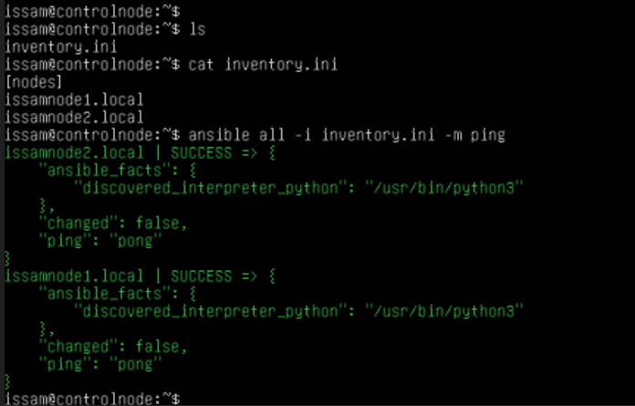

# Labb 1 – Miljöuppsättning och lösenordsfri SSH

## Genomförande

Jag skapade tre virtuella Ubuntu-servrar i Hyper-V: `controlnode`, `issamnode1` och `issamnode2`. Jag installerade mDNS med `avahi-daemon` så att noderna kunde nås via sina namn med ändelsen `.local`.

Från `controlnode` konfigurerade jag SSH-nycklar för att kunna ansluta till båda målnoderna utan lösenord. Jag installerade även Ansible på `controlnode` och skapade en inventory-fil med båda noderna:

```ini
[nodes]
issamnode1.local
issamnode2.local
```

## Problem och lösning

Det enda problemet jag stötte på var att noderna först hette `node1` och `node2`, precis som de andra elevernas noder. De gemensamma värdnamnen gjorde det svårt att ansluta till rätt nod via mDNS och gav problem med SSH-autentiseringen.

Jag bytte därför namn på mina noder till `issamnode1` och `issamnode2`. Efter namnbytet fungerade SSH-nycklarna och autentiseringen mot båda noderna utan problem.

## Verifiering och resultat

Jag körde följande kommando från `controlnode` för att verifiera anslutningen:

```bash
ansible all -i inventory.ini -m ping
```

Både `issamnode1.local` och `issamnode2.local` svarade med `SUCCESS` och `"ping": "pong"`. Det visar att Ansible kunde ansluta till båda målnoderna och köra ping-modulen.



## Körbar inventory

I Lab 12 kompletterades [inventory.ini](inventory.ini) med samma noder och
ansible_user satt till issam, så att anslutningstestet kan köras från repot.
