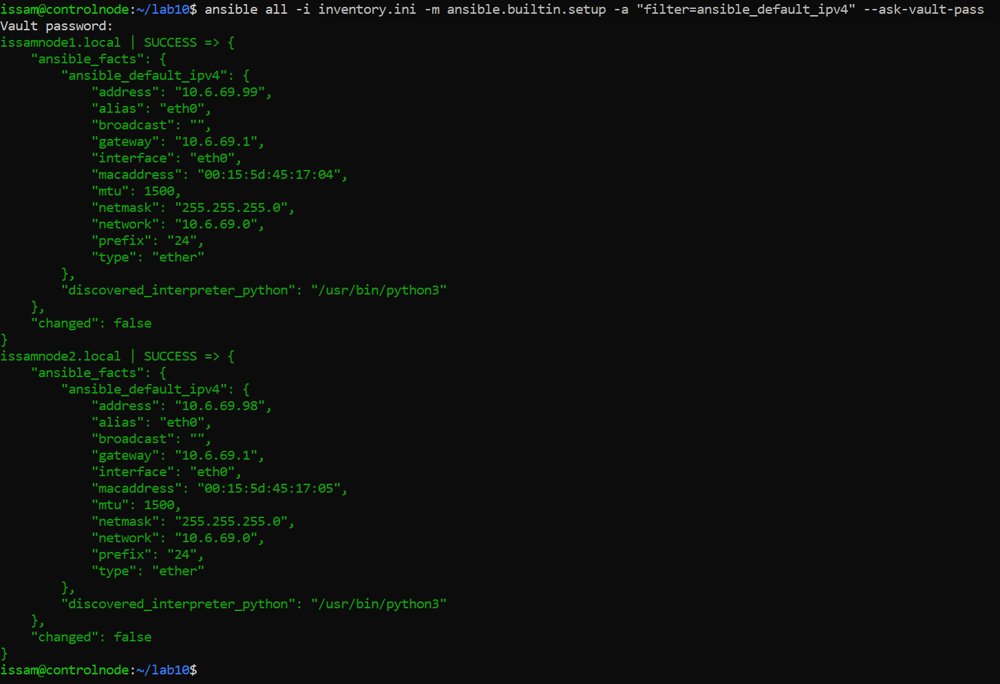
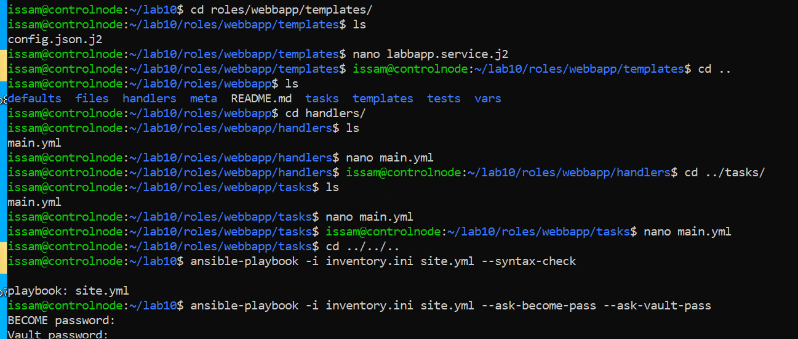
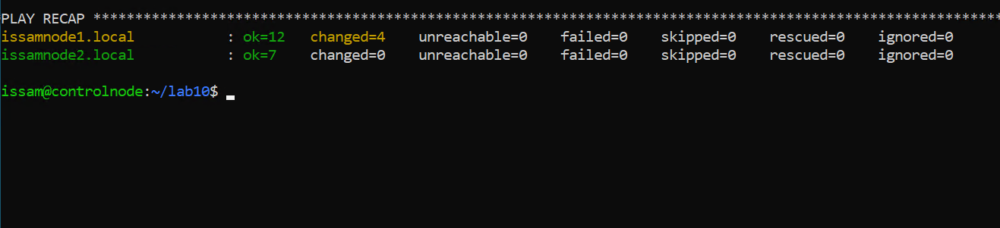
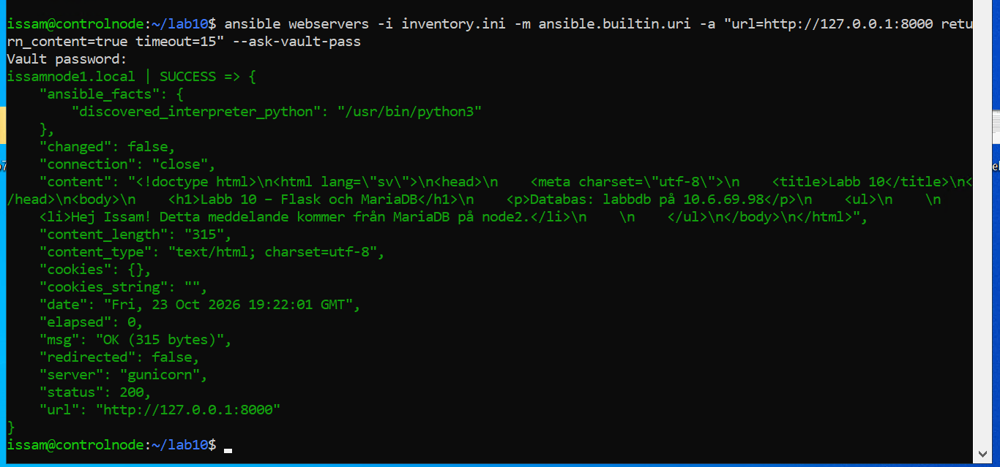
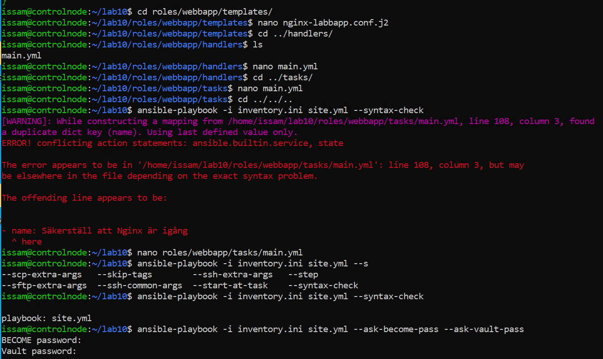
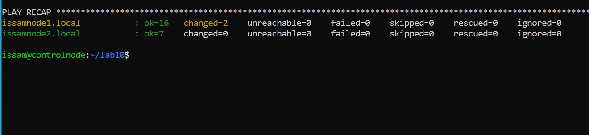
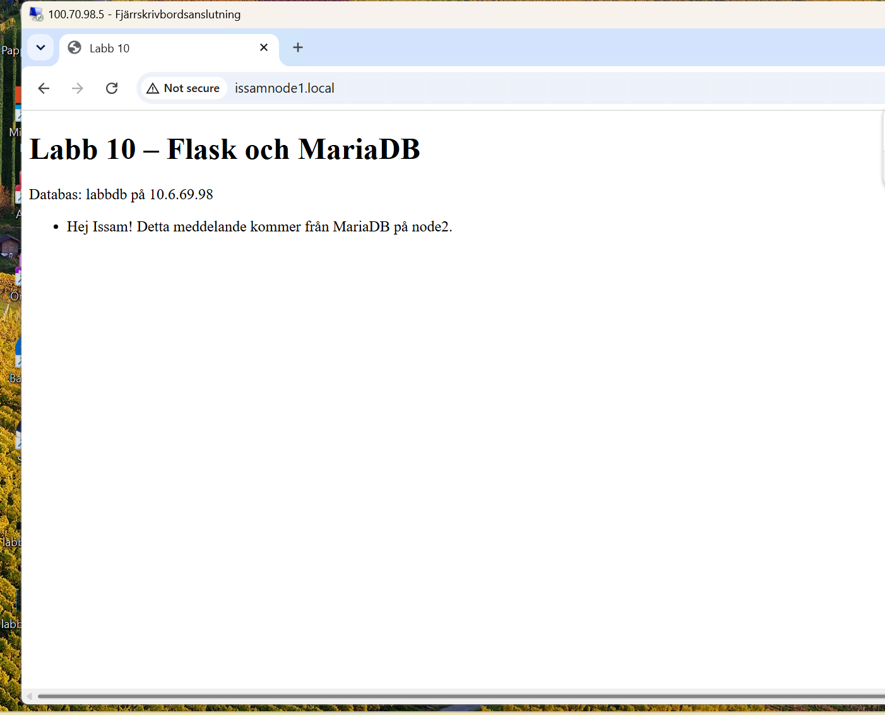
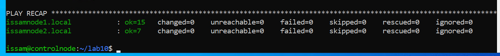

# Lab 10 – Flask, Nginx och MariaDB (VG)

I det här labbandet kopplade jag ihop webbservern på node1 med databasen på
node2. Utgick från Lab 7 och byggde vidare med Flask, Gunicorn och Nginx.
Målet var att få hela kedjan att fungera genom Ansible och kunna visa ett
meddelande som faktiskt hämtas från databasen.

Allt konfigurerades från controlnode. Flödet blev:

**Webbläsare → Nginx på port 80 → Gunicorn/Flask på port 8000 → MariaDB på port 3306.**

## Miljö och variabler

Arbetade i /home/issam/lab10 och återanvände min fungerande inventory.
Började med pingtest mot båda noderna och kontrollerade sedan IP-adresserna
med setup-modulen.

| Server | IP-adress | Uppgift |
| --- | --- | --- |
| issamnode1.local | 10.6.69.99 | Nginx, Gunicorn och Flask |
| issamnode2.local | 10.6.69.98 | MariaDB |



Samlade inställningarna i [group_vars/all/main.yml](lab10/group_vars/all/main.yml):

```yaml
db_host: "10.6.69.98"
db_port: 3306
db_name: "labbdb"
db_user: "labbapp"

web_host: "10.6.69.99"
```

Här fick jag hålla isär adresserna. db_host är databasen som webbappen ska
ansluta till. web_host används för att ange från vilken IP databasanvändaren
får ansluta.

Lösenordet ligger i den krypterade Vault-filen från tidigare labb. Webbappens
konfiguration skapas på node1 med rättigheten 0640 och gruppen webapp.
Använde även no_log: true och diff: false på den uppgiften så att lösenordet
inte skrivs ut vid körningen.

## Databasen på node2

Rollen [database](lab10/roles/database/tasks/main.yml) installerar MariaDB och
Python-stödet, startar tjänsten och gör att den startar vid uppstart.
Med en Jinja2-mall satte jag bind-address till databasnodens IP-adress.
När den konfigurationen ändras anropas en handler som startar om MariaDB.

I [site.yml](lab10/site.yml) skapade jag databasen labbdb, databasanvändaren
labbapp och tabellen messages med ett testmeddelande. Kontot får ansluta
från node1 och har SELECT-behörighet i labbdb, vilket räcker för att läsa
meddelandet.

Testade också anslutningen från webbservern till 10.6.69.98 på port 3306 med
wait_for. Det gav SUCCESS. Då visste jag att node1 nådde databasporten innan
jag gick vidare med själva webbappen.

## Webbappen på node1

I rollen [webbapp](lab10/roles/webbapp/tasks/main.yml) installerade jag Nginx
och Python-verktygen. Flask, Gunicorn och PyMySQL installerades i en virtuell
miljö under /opt/labbapp/venv.

[app.py](lab10/roles/webbapp/files/app.py) läser databasinställningarna från
/etc/labbapp/config.json och hämtar meddelandet med:

```sql
SELECT id, message FROM messages ORDER BY id
```

Resultatet visas sedan på webbsidan. Gunicorn kör appen på 127.0.0.1:8000,
och en systemd-tjänst håller den igång med tjänstekontot webapp.
Konfigurationsändringar meddelar handlern Starta om webbappen.

Kontrollerade syntaxen och körde playbooken från /home/issam/lab10:

```bash
ansible-playbook -i inventory.ini site.yml --syntax-check --ask-vault-pass
ansible-playbook -i inventory.ini site.yml --ask-become-pass --ask-vault-pass
```

Bilderna visar min navigering mellan mallar, handlers och tasks, följt av
körningen när webbappen och tjänsten lagts till.





Testade sedan appen lokalt på node1 med Ansibles uri-modul mot
http://127.0.0.1:8000. Fick HTTP 200 från Gunicorn och meddelandet från MariaDB.
Då fungerade anslutningen och läsningen från databasen också.



## Nginx och egen felsökning

Nästa steg var att låta Nginx ta emot anropen på port 80 och skicka dem
vidare till Gunicorn. Det styrs av
[nginx-labbapp.conf.j2](lab10/roles/webbapp/templates/nginx-labbapp.conf.j2).
Playbooken kontrollerar konfigurationen med nginx -t och laddar om Nginx
via en handler när konfigurationen ändras.

Här fick jag fel vid syntaxkontrollen. Läste felmeddelandet, gick tillbaka
till roles/webbapp/tasks/main.yml och rättade. Sedan körde jag syntaxkontrollen
igen och fick godkänt innan jag startade playbooken.





Vid den körningen fick node1 ok=16 och changed=2. Node2 hade ok=7 och
changed=0. Båda hade failed=0 och unreachable=0.

## Slutlig kontroll

Testade hela kedjan från controlnode:

```bash
curl -i --max-time 15 http://issamnode1.local/
```

Fick HTTP 200 och meddelandet från databasen. Öppnade även sidan i
webbläsaren och fick samma resultat.



Kontrollerade även idempotensen genom att köra samma playbook igen.

| Server | ok | changed | unreachable | failed |
| --- | --- | --- | --- | --- |
| issamnode1.local | 15 | 0 | 0 | 0 |
| issamnode2.local | 7 | 0 | 0 | 0 |



Det behövdes inga ändringar vid omkörningen. Playbooken kontrollerade
inställningarna igen och det som hanterades var redan i önskat läge.

## Min reflektion

Det blev ett långt labbande med många filer att hålla reda på. Gjorde det
med vägledning och tog en del i taget, först databasen och sedan webbappen
och Nginx. Det hjälpte att testa mellan stegen så att jag visste vilken del
som fungerade innan jag fortsatte.

Fick rätta en del skrivfel och hamnade även i fel mapp någon gång.
Skrev först webapp i playbooken fast rollen hette webbapp. Det såg jag själv
när jag läste felmeddelandet och jämförde med mappnamnet. Samma sak mot slutet
med syntaxfelet i Nginx-uppgiften. Märker att jag börjar hitta tillbaka till
rätt fil och rätta mer på egen hand.

## Filer

Labbkoden ligger i [lab10](lab10/). Där finns [site.yml](lab10/site.yml),
[inventory.ini](lab10/inventory.ini), rollerna och variablerna.
[requirements.yml](lab10/requirements.yml) anger community.mysql 3.16.0.
Körningarna gjordes på controlnode med SSH-åtkomsten och Vault-lösenordet
från tidigare labbar.
