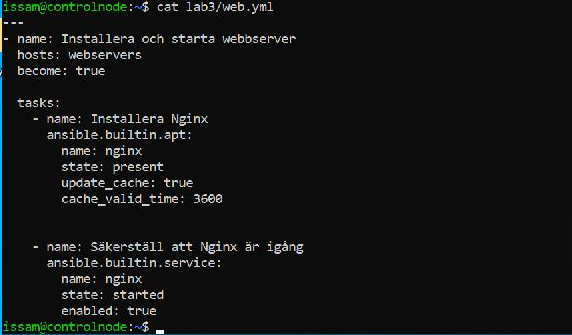
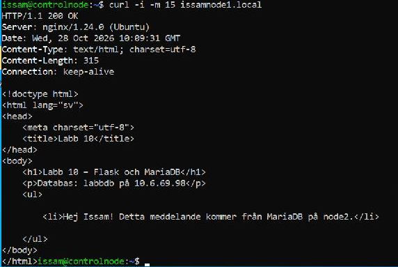

# Lab 12 – Sammanställning och arkitektur (VG)

Här samlade vi ihop det vi gjort i labbarna och gick igenom VG-kraven.
Fick ordning på filerna som saknades, körinstruktionerna och beskrivningen
av hur miljön hänger ihop. Labbarna ligger kvar i egna mappar med kod,
rapporter och bilder.

Arkitekturmotiveringen finns i [ARCHITECTURE.md](../ARCHITECTURE.md).
Den följer lärarens fyra områden och är cirka 780 ord, inom kravet på
500–1000 ord. [README.md](../README.md) visar förutsättningarna och de
exakta kommandona för att köra projektet.

## Kraven och var de finns

| Krav | Underlag |
| --- | --- |
| Labbar 1–11 samlade med kod och redovisning | [Översikten i README](../README.md) länkar till samtliga labbar. |
| Logisk struktur med roller och variabler | Roller ligger intill respektive playbook. Lab 7 och 10 har group_vars/all. |
| VG i Lab 5 | [common och webserver samt körningsresultat](../labb-5/rapport.md) |
| VG i Lab 7 | [Databasroll, Vault och databasanvändare](../labb-7/rapport.md) |
| VG i Lab 8 | [Serverrapporter, relationer och konsekvenser vid avbrott](../labb-8/rapport.md) |
| VG i Lab 10 | [Flask, Gunicorn/Nginx, MariaDB och verifierad dataläsning](../labb-10/rapport.md) |
| Skriftlig arkitekturmotivering | [ARCHITECTURE.md](../ARCHITECTURE.md) täcker verktygsval, säkerhet, skalbarhet och drift. |
| Flyttbarhet efter kloning | Relativa källsökvägar och uppdaterat inventoryskript. Körinstruktioner finns i README. |
| Hemligheter och tillfälliga filer | Vault-filer, no_log, filbehörigheter och kontrollerad .gitignore. |
| Privat repo med läraråtkomst | Repot är privat och Stefan har åtkomst. Det bekräftade jag vid sammanställningen. |

Lab 11 har ingen egen VG-del. [Jämförelsen mellan Ansible och Puppet](../labb-11/rapport.md)
finns med som underlag för verktygsvalet.

## Det jag fixade i repot

I Lab 3 fanns koden som bild, men inventory.ini och web.yml hade inte
kommit med i repot. Vi lade till filerna och jämförde playbooken med
originalet i /home/issam/lab3 på controlnode. Det var samma uppgifter
och inställningar.



Lab 1 fick en inventory-fil med samma noder som i redovisningen.
En gemensam [requirements.yml](../requirements.yml) samlar de två
Ansible-samlingarna som behövs: ansible.posix 1.5.4 och community.mysql 3.16.0.

I Lab 9 pekade skriptet direkt på /home/issam/lab9/servers.json. Det
behövde ändras för att fungera när repot ligger i en annan mapp.
Med Path(__file__).resolve().with_name('servers.json') hittar det nu
filen bredvid Pythonfilen. Argumenten fungerar som tidigare.
[Lab 9-rapporten](../labb-9/rapport.md) skiljer på den tidigare versionen
och ändringen som gjordes här.

I [relationsfilen från Lab 8](../labb-8/relations.md) lade jag till att den
beskriver hur miljön såg ut då. I Lab 10 kopplade vi ihop webbappen och
databasen, så där finns ett beroende som inte fanns i Lab 8.

## Lokala kontroller den 28 oktober 2026

Kodkontrollerna gjordes i Ubuntu/WSL med ansible-core 2.16.3,
ansible.posix 1.5.4 och community.mysql 3.16.0.

| Playbook | Syntaxkontroll |
| --- | --- |
| labb-3/web.yml | rc=0 |
| labb-4/users.yml | rc=0 |
| labb-5/site.yml | rc=0 |
| labb-6/site.yml | rc=0 |
| labb-7/site.yml | rc=0 |
| labb-8/inventory_report.yml | rc=0 |
| labb-10/lab10/site.yml | rc=0 |

Alla sju gav rc=0. Kontrollerna kördes från repots rot med rätt inventory
och --syntax-check. Det visar att playbooks och roller går att läsa och
att modulerna hittas. Körningarna mot själva noderna finns redovisade
i de tidigare labbarna.

Även följande kontroller gjordes:

- 53 vanliga YAML-filer, två Python-filer och sju Jinja2-mallar passerade strukturkontrollerna.
- Båda Vault-filerna hade krypterat format. Inget Vault-lösenord behövdes för syntaxkontrollerna.
- Inventoryskriptet provades från en annan sökväg, med / som arbetsmapp. --list gav rätt JSON, --host gav {} och Ansible kunde tolka grupperna och variablerna.
- Textgranskningen hittade inga privatnycklar eller okrypterade lösenordsfält i arbetsfilerna eller de 59 granskade textversionerna i nåbar Git-historik.
- .gitignore provades med namn för Vault-lösenordsfil, privata nycklar, logg och retry-fil. Samtliga matchade reglerna.
- Skärmbilderna från Lab 7 granskades också visuellt. De visar frågor efter lösenord och resultat, utan lösenordens innehåll.

Sökningen efter hemligheter letade efter typiska mönster i textfilerna.
Syntaxkontrollerna och testet av den körande webbappen redovisas var för sig.

## Aktuell kontroll i labbmiljön

Jag testade också webbappen igen från controlnode:

```bash
curl -i -m 15 issamnode1.local
```

Det gav HTTP/1.1 200 OK från Nginx och meddelandet:

> Hej Issam! Detta meddelande kommer från MariaDB på node2.

Sidan visade labbdb på 10.6.69.98 och meddelandet från node2. Hela flödet
fungerade alltså fortfarande den 28 oktober. I Lab 10 finns också den
tidigare omkörningen där båda noderna hade changed=0, failed=0 och
unreachable=0.



## Min reflektion

Jag tog mer hjälp av Codex med den här delen, framför allt med att
samla ihop projektet och kontrollera filerna. Efteråt läste jag igenom ordentligt så jag har koll på rapporten, arkitekturen och det som ändrats i repot.

Vill kunna förklara hur delarna hänger ihop och varför jag gjort de
valen, det känns som man fått grepp om en del delar när det gäller Ansible. Det är också därför jag vill göra om labbarna när allt är genomläst och pushat. Efter "labb-12" så är planen att nollställa allt, göra om samtliga 12 labbar igen för att fortsätta fila på viktiga kompetenser inför LIA.

Då börjar jag från början och styr arbetet själv. Jag planerar,
skriver koden och felsöker, medan Codex granskar och hjälper mig
rätta. Då märker jag vad som sitter och vad jag behöver träna mer på. Samt hämtar all befintlig material från nätet som ansible docs, w3 school, red hat m.m.

## Kursmaterial

Examinerande Laborationer, Lab 12, sidorna 8–10.
