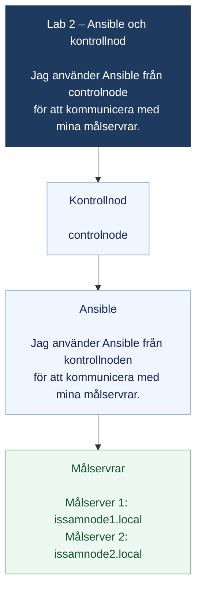
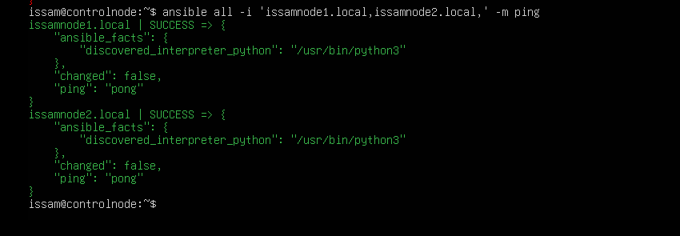
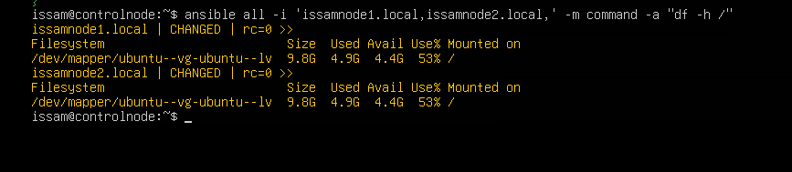
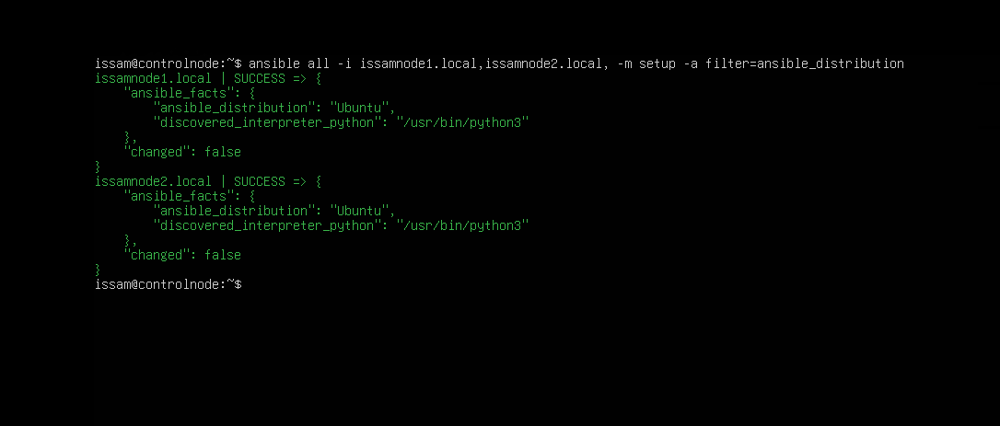

# Lab 2 – Ansible och kontrollnod

Använder mermaid för lite schysstare layout.

Jag använder kontrollnoden `controlnode`, där jag har verifierat att jag är
inloggad som användaren `issam`.

Jag använder två målservrar:

- Målserver 1 har hostname `issamnode1` och mDNS-namnet `issamnode1.local`.
- Målserver 2 har hostname `issamnode2` och mDNS-namnet `issamnode2.local`.

På kontrollnoden har jag verifierat att Ansible är installerat. Versionen är
Ansible core 2.16.3, vilket jag har bekräftat genom en bild från min terminal
med kommandot:

```bash
ansible --version
```

## Labbmiljö och anslutning

Diagrammet visar hur jag använder kontrollnoden för att kommunicera med de två
målservrarna:



IP-adresserna i filen `ip addresser linux.txt` är tidigare anteckningar och jag
har inte verifierat dem på nytt.

## Lab 2

Jag har verifierat att kontrollnoden och Ansible fungerar. Jag har också
verifierat anslutningen till båda de nya namnen. Anslutningen lyckades och
resultatet blev `SUCCESS` och `pong`.

Jag använde följande kommando:

```bash
ansible all -i 'issamnode1.local,issamnode2.local,' -m ping
```

Resultatet blev att båda målservrarna svarade med `SUCCESS` och `pong`.



## Reflektion

En egen reflektion är att det är bra att använda kontrollnoden när jag ska
hantera flera noder i samma nätverk. Även om det bara var två noder kan jag
köra Ansible från kontrollnoden och rikta kommandona mot mina målservrar.
Alternativet `-i` anger vilka målservrar som ska användas. På det här sättet
kan jag arbeta mer automatiserat, slippa skriva samma kommandon flera gånger
och spara tid.

## Verifiering av målservrarna

Jag har kört följande kommando för att kontrollera diskutrymmet på båda
noderna:

```bash
ansible all -i 'issamnode1.local,issamnode2.local,' -m command -a "df -h /"
```

Båda noderna gav `rc=0`. Resultatet visade totalt `9.8G`, varav `4.9G` var
använt, `4.4G` var tillgängligt och användningen var `53%`.



Jag använde även Ansible-modulen `setup` med filtret
`ansible_distribution` för att kontrollera vilken Linux-distribution som
används på målservrarna:

```bash
ansible all -i 'issamnode1.local,issamnode2.local,' -m setup -a "filter=ansible_distribution"
```

Båda noderna gav `SUCCESS` och distributionen identifierades som `Ubuntu`.

