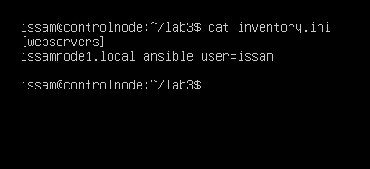
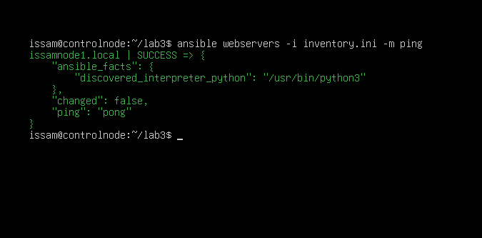
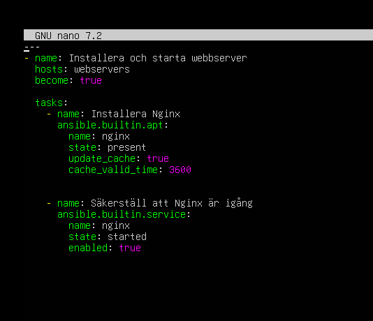
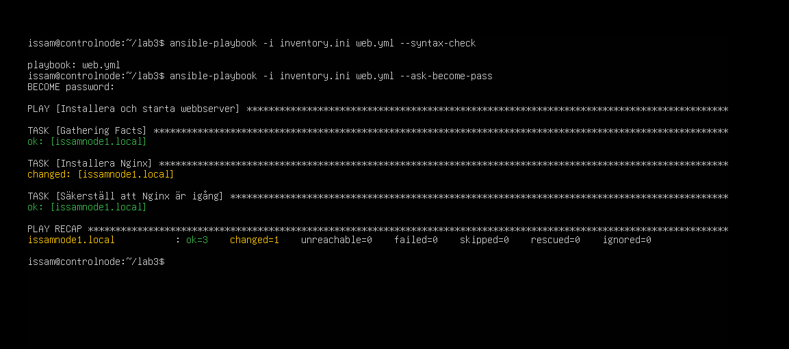
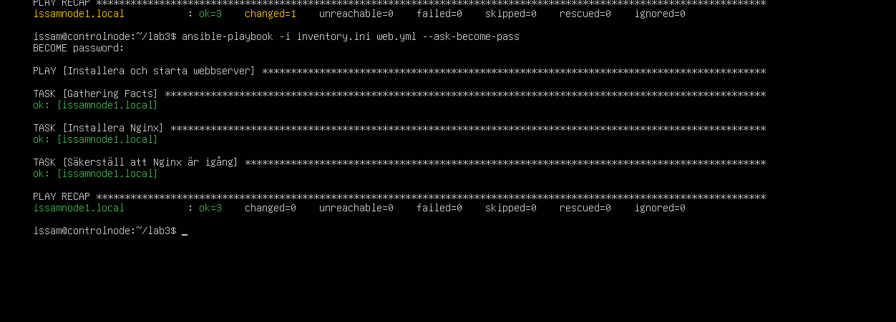
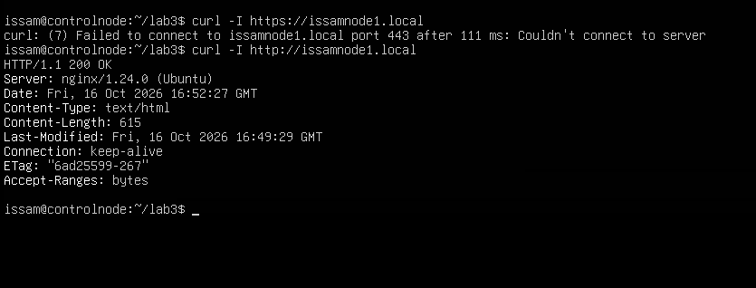

# Lab 3 – Min första playbook och idempotens
Rapport skapad med mermaid.
Jag körde Ansible från controlnode och satte upp Nginx på issamnode1.local.

## Inventory

Jag skapade inventory.ini och lade min första nod i gruppen webservers:

```ini
[webservers]
issamnode1.local ansible_user=issam
```



## Test av anslutningen

Jag använde följande kommando:

```bash
ansible webservers -i inventory.ini -m ping
```

Jag fick SUCCESS och pong från min nod.



## Playbooken web.yml

Jag använde hosts: webservers för att välja min nod och become: true för att
använda sudo.

Med apt och state: present installerade jag Nginx.
Med service och state: started såg jag till att Nginx kördes.
enabled: true gör att tjänsten startar efter en omstart.
cache_valid_time: 3600 låter paketlistan återanvändas i en timme.



## Kontroll av syntaxen

Jag använde följande kommando:

```bash
ansible-playbook -i inventory.ini web.yml --syntax-check
```

Kontrollen gick igenom utan fel.



## Första körningen

Jag använde följande kommando:

```bash
ansible-playbook -i inventory.ini web.yml --ask-become-pass
```

Resultat: ok=3, changed=1, failed=0.
Installationsuppgiften gjorde en ändring.
Kontrollen av tjänsten visade att Nginx redan var igång och aktiverat för
automatisk start.

## Andra körningen

Jag använde följande kommando:

```bash
ansible-playbook -i inventory.ini web.yml --ask-become-pass
```

Jag körde samma playbook igen utan att ändra filen.
Resultat: ok=3, changed=0, failed=0.



## Kontroll av webbservern

Jag testade först:

```bash
curl -I https://issamnode1.local
```

Det fungerade inte eftersom jag inte hade satt upp HTTPS.

Sedan körde jag:

```bash
curl -I http://issamnode1.local
```

Jag fick HTTP/1.1 200 OK
och Server: nginx/1.24.0 (Ubuntu).



## Min förklaring av idempotens

Andra körningen gav changed=0 eftersom Nginx redan var installerat, igång och
aktiverat för automatisk start.
Ansible kontrollerade läget och behövde inte ändra något.

Jag körde allt från controlnode, men inventory och hosts: webservers styrde att
jobbet gjordes på issamnode1.
