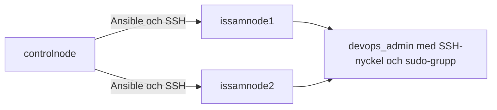
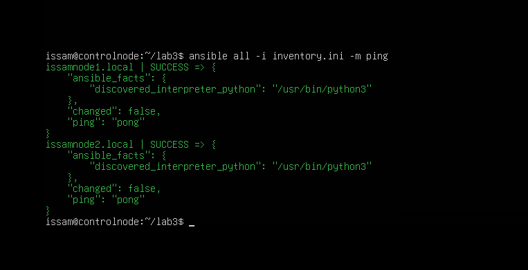
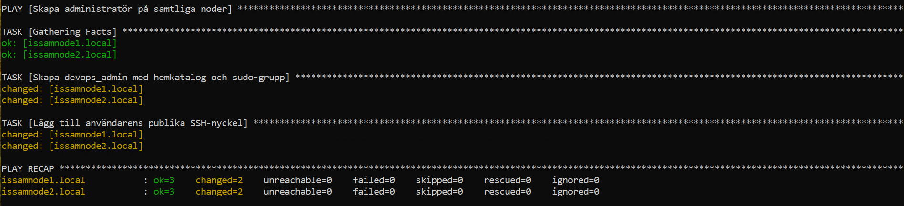
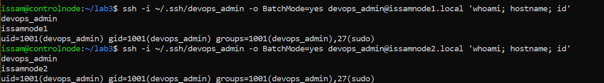

# Lab 4 – Användar- och Behörighetshantering

I den här labben skapade jag devops_admin på issamnode1.local och
issamnode2.local med Ansible. Kontot skulle ha en egen hemkatalog, tillhöra
sudo-gruppen och kunna logga in med en egen SSH-nyckel.

Allt kördes från controlnode. Det blev ett sätt att bygga vidare på
anslutningarna från tidigare labbar och använda dem för att konfigurera
samma användare på båda noderna.



## Inventory

Min inventory från tidigare innehöll bara första noden. För den här labben
lade jag till issamnode2 också:

```ini
[webservers]
issamnode1.local ansible_user=issam

[other]
issamnode2.local ansible_user=issam
```

Gruppen all omfattar båda noderna i filen. Det var viktigt här eftersom
användaren skulle finnas på båda servrarna, även om de ligger i olika grupper.

## Test av anslutningen

Innan jag gick vidare testade jag att båda noderna svarade:

```bash
ansible all -i inventory.ini -m ping
```

Resultatet blev SUCCESS och pong från båda. Då visste jag att anslutningarna
fungerade innan jag började med användaren och nyckeln.



## SSH-nyckeln

På controlnode skapade jag ett separat nyckelpar för devops_admin:

```bash
ssh-keygen -t ed25519 -f ~/.ssh/devops_admin -C "devops_admin@controlnode"
```

Lösenfrasen lämnades tom i den här labben. Den privata nyckeln stannade på
controlnode och den publika nyckeln devops_admin.pub användes i playbooken.

Här behövde jag hålla isär nycklarna. Den publika delen läggs på noderna,
medan den privata används från controlnode när jag ansluter.

## Playbooken users.yml

För att kunna använda authorized_key installerade jag samlingen ansible.posix:

```bash
ansible-galaxy collection install ansible.posix
```

I users.yml valde jag båda noderna med hosts: all. become: true gör att
uppgifterna körs med sudo på noderna, vilket behövs för att skapa kontot.

```yaml
---
- name: Skapa administratör på samtliga noder
  hosts: all
  become: true

  tasks:
    - name: Skapa devops_admin med hemkatalog och sudo-grupp
      ansible.builtin.user:
        name: devops_admin
        state: present
        create_home: true
        shell: /bin/bash
        groups: sudo
        append: true

    - name: Lägg till användarens publika SSH-nyckel
      ansible.posix.authorized_key:
        user: devops_admin
        state: present
        key: "{{ lookup('file', '~/.ssh/devops_admin.pub') }}"
```

Första uppgiften skapar kontot med hemkatalog och medlemskap i sudo.
append: true behåller eventuella andra gruppmedlemskap.
Andra uppgiften lägger till den publika nyckeln på båda noderna.
lookup läser nyckelfilen från controlnode.

Det blev tydligare för mig hur uppgifterna bygger på varandra. Kontot och
hemkatalogen behöver finnas innan nyckeln läggs till för den användaren.

## Körning av playbooken

När filen var klar körde jag:

```bash
ansible-playbook -i inventory.ini users.yml --ask-become-pass
```

Vid lösenordsfrågan angav jag sudo-lösenordet för issam.
Båda noderna gav ok=3, changed=2, unreachable=0 och failed=0.
De två ändringarna var att användaren skapades och att den publika
SSH-nyckeln lades till.



## Verifiering av inloggningen

Efter körningen testade jag inloggningen från controlnode:

```bash
ssh -i ~/.ssh/devops_admin -o BatchMode=yes devops_admin@issamnode1.local 'whoami; hostname; id'
ssh -i ~/.ssh/devops_admin -o BatchMode=yes devops_admin@issamnode2.local 'whoami; hostname; id'
```

Båda svarade med devops_admin och rätt servernamn. Grupplistan visade
27(sudo) på båda noderna.

Med -i valde jag nyckeln som skapades för kontot. BatchMode=yes gör att SSH
inte frågar efter lösenord, så det lyckade testet bekräftade att
nyckelinloggningen fungerade. Med whoami, hostname och id kunde jag samtidigt
kontrollera användaren, servern och grupperna.



## Min reflektion

Det som blev tydligare i den här labben var hur inventory, playbook och
SSH-nycklarna hänger ihop. Jag satt kvar på controlnode men samma uppgifter
skapade användaren på båda servrarna. Inventory och hosts: all styrde var
jobbet gjordes.

Det räckte inte heller att bara se att playbooken kördes utan fel.
När jag sedan kunde ansluta som devops_admin och se rätt servernamn och
sudo-grupp fick jag bekräftat att det faktiskt fungerade på båda noderna.

För mig visar det nyttan med automatiseringen. Jag behövde inte gå in på
varje server och skapa kontot och lägga dit nyckeln manuellt. Samma playbook
hanterade båda, och inloggningen fungerade utan kontolösenord.
