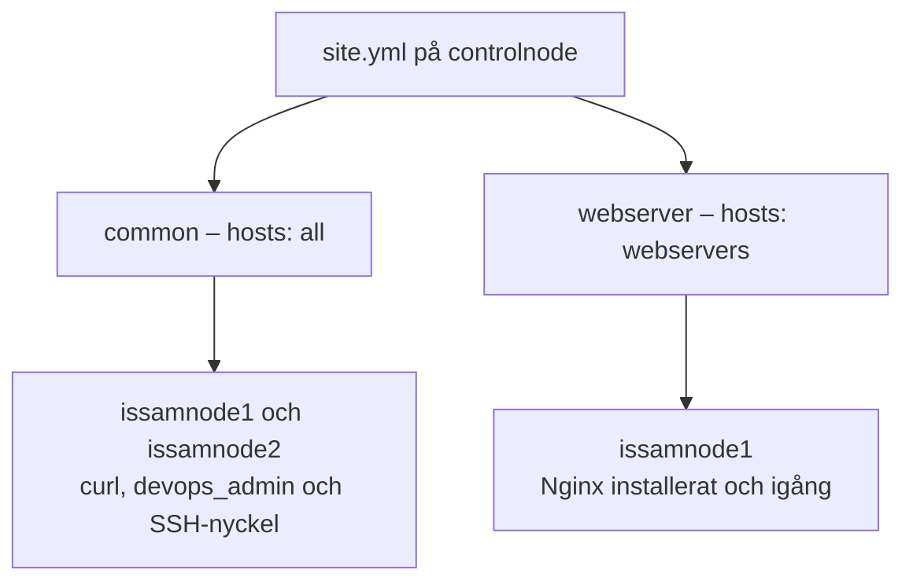
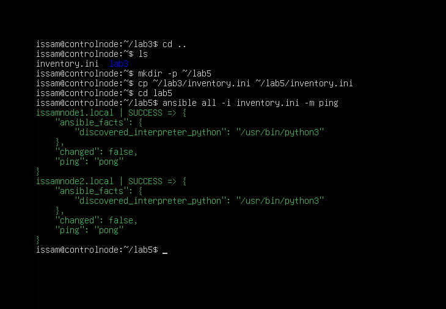
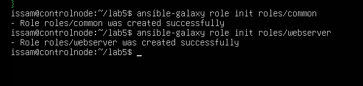
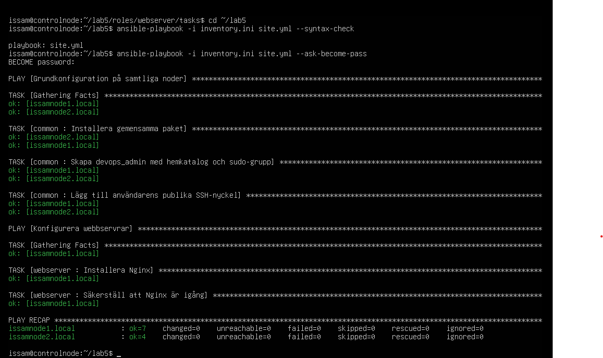
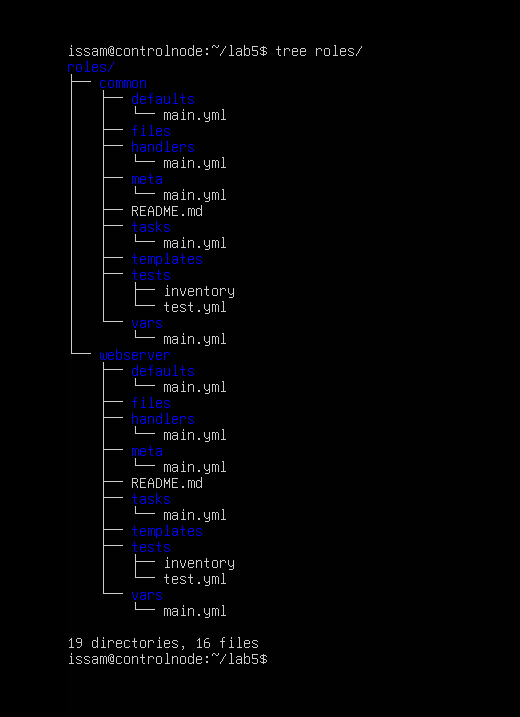
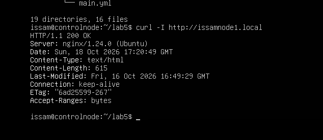

# Lab 5 – Strukturering med Ansible Roles för VG

I den här labben byggde jag vidare på det jag gjorde i Lab 3 och 4.
Jag delade upp uppgifterna i två roller, common och webserver, och skapade
site.yml som anropar dem. Allt kördes från controlnode mot mina två noder.

Det jag ville få grepp om här var hur filerna hänger ihop. Tidigare skrev jag
uppgifterna direkt i playbooken. Nu ligger de i rollerna och huvud-playbooken
styr vilka noder som ska få vilken roll.



## Inventory och test av anslutningen

Jag skapade en egen arbetsmapp för Lab 5 och kopierade min inventory från
föregående labb:

```bash
mkdir -p ~/lab5
cp ~/lab3/inventory.ini ~/lab5/inventory.ini
cd ~/lab5
```

Min inventory innehåller båda noderna:

```ini
[webservers]
issamnode1.local ansible_user=issam

[other]
issamnode2.local ansible_user=issam
```

Jag testade kontakten innan jag gick vidare:

```bash
ansible all -i inventory.ini -m ping
```

Båda noderna svarade med SUCCESS och pong. Då visste jag att Ansible kunde
ansluta och köra modulen på båda.



## Skapa rollerna

Jag skapade båda rollerna med följande kommandon:

```bash
ansible-galaxy role init roles/common
ansible-galaxy role init roles/webserver
```

Kommandona skapade mappar och mallfiler på controlnode. De gjorde ingen
installation på noderna. Det var först när jag körde site.yml som uppgifterna
utfördes där.



## Rollen common

I [roles/common/tasks/main.yml](roles/common/tasks/main.yml) lade jag tre uppgifter:

- Säkerställa att curl är installerat.
- Säkerställa att devops_admin finns med hemkatalog och medlemskap i sudo.
- Lägga till användarens publika SSH-nyckel.

Jag återanvände användaruppgifterna från Lab 4. Med create_home: true får
användaren sin hemkatalog och append: true behåller eventuella andra
gruppmedlemskap. Nyckeln läses från controlnode med lookup och läggs på
noderna med authorized_key.

Här blev uppdelningen tydligare för mig. Common innehåller det som båda mina
noder ska ha. Om jag lägger till fler noder i min inventory kan samma roll
användas där också.

## Rollen webserver

I [roles/webserver/tasks/main.yml](roles/webserver/tasks/main.yml) lade jag
Nginx-uppgifterna från Lab 3.

Jag använde apt med state: present för installationen och service med
state: started för att säkerställa att Nginx körs. enabled: true gör att
tjänsten startar efter en omstart. Paketlistan kan återanvändas i en timme
med cache_valid_time: 3600.

Jag råkade först skriva bultin i stället för builtin i apt-modulens namn.
Jag rättade det innan syntaxkontrollen. Det är en liten stavning men den
avgör om Ansible hittar rätt modul.

I rollernas tasks/main.yml skrev jag bara uppgifterna. Hosts och become ligger
i site.yml, där jag väljer vilka noder uppgifterna ska köras på och att sudo
ska användas.

## Huvud-playbooken site.yml

Min huvud-playbook ser ut så här:

```yaml
---
- name: Grundkonfiguration på samtliga noder
  hosts: all
  become: true
  roles:
    - common

- name: Konfigurera webbservrar
  hosts: webservers
  become: true
  roles:
    - webserver
```

Först körs common på båda noderna. Sedan körs webserver på issamnode1,
som ligger i gruppen webservers. Issamnode2 får alltså grundkonfigurationen
men ingen Nginx-installation från den här playbooken.

Det är så jag förstår kedjan: inventory listar servrarna, site.yml väljer
noder och roller, och rollerna innehåller uppgifterna. Ansible hittar
rollernas tasks/main.yml automatiskt genom mappstrukturen.

## Kontroll och körning

Jag kontrollerade syntaxen först:

```bash
ansible-playbook -i inventory.ini site.yml --syntax-check
```

Kontrollen gick igenom utan fel. Sedan körde jag:

```bash
ansible-playbook -i inventory.ini site.yml --ask-become-pass
```

Jag skrev sudo-lösenordet för issam när det efterfrågades.

| Nod | ok | changed | unreachable | failed |
| --- | --- | --- | --- | --- |
| issamnode1.local | 7 | 0 | 0 | 0 |
| issamnode2.local | 4 | 0 | 0 | 0 |

Issamnode1 fick fler uppgifter eftersom den körde båda rollerna.
Issamnode2 körde bara common. Faktainsamlingen räknas också med i ok,
och den gjordes igen på issamnode1 i playbookens andra del.

Båda gav changed=0 redan vid den här körningen. Paketen, användaren,
SSH-nyckeln och Nginx hade redan rätt tillstånd. Att jag flyttade koden till
roller gjorde inte att Ansible behövde ändra sådant som redan stämde.
Det kopplar tillbaka till idempotens från Lab 3.



## Mappstrukturen

Jag visade rollstrukturen med:

```bash
tree roles/
```

Båda rollerna har en egen tasks/main.yml. De andra mapparna skapades av
role init och jag lät dem vara kvar. Jag har ännu inte lagt några egna
uppgifter i exempelvis handlers eller templates.



## Kontroll av webbservern

Till sist testade jag att Nginx fortfarande svarade:

```bash
curl -I http://issamnode1.local
```

Jag fick HTTP/1.1 200 OK och Server: nginx/1.24.0 (Ubuntu).



## Min reflektion

Det som föll på plats för mig var att en roll samlar uppgifter som hör ihop.
Jag behöver fortfarande en huvud-playbook som väljer var de ska köras.
Jag kan återanvända common på båda noderna och samtidigt hålla Nginx till
min webbserver.

Det blev lättare att följa när jag såg common och webserver i utskriften
från körningen. Jag kunde se vilken roll varje uppgift kom från och vilka
noder som fick den.

Om jag senare vill lägga till ett gemensamt paket kan jag ändra common.
Vill jag ändra webbservern går jag till webserver. Jag slipper lägga samma
användaruppgifter i flera olika playbooks och sedan hålla alla kopior uppdaterade.

Även intressant att se hur allt hänger ihop vi använder tidigare inventories
vi skapat, skapar instruktioner/uppgifter i våra tasks och sedan körs de via vår
huvud playbook det visar på att automatisering ger noggrannhet och minskar risken för fel än om man hade behövt konfigurera detta manuellt.
Det är vid dessa typer av uppgifter man börjar se hur allt verkligen hänger ihop.

## Filer och förutsättningar

Koden finns i [site.yml](site.yml), [inventory.ini](inventory.ini) och
[roles/](roles/). Körningen gjordes från ~/lab5 på controlnode.
Samlingen ansible.posix och nyckelfilen ~/.ssh/devops_admin.pub fanns kvar
från Lab 4. Den privata SSH-nyckeln ligger kvar på controlnode och finns
inte i labbmappen.
