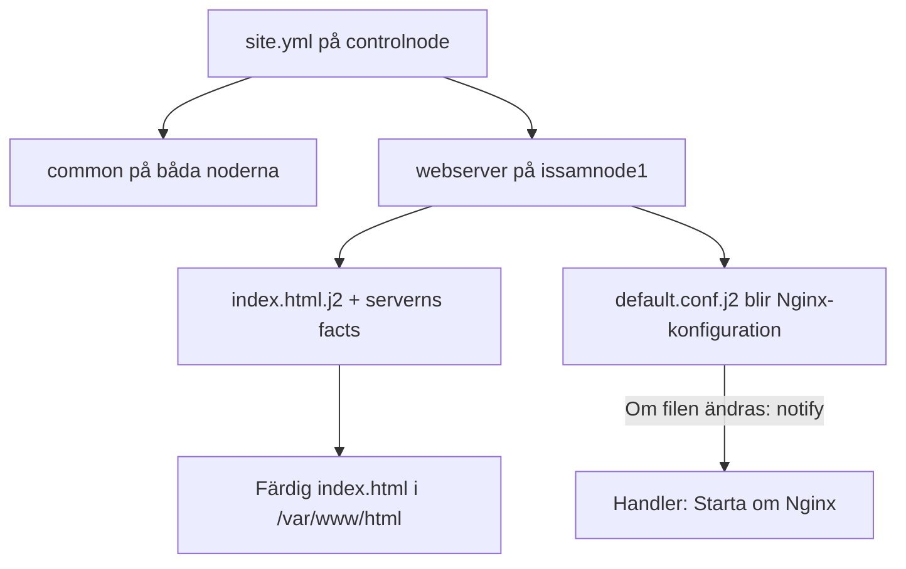
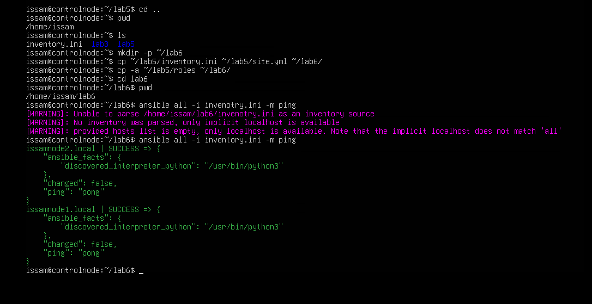
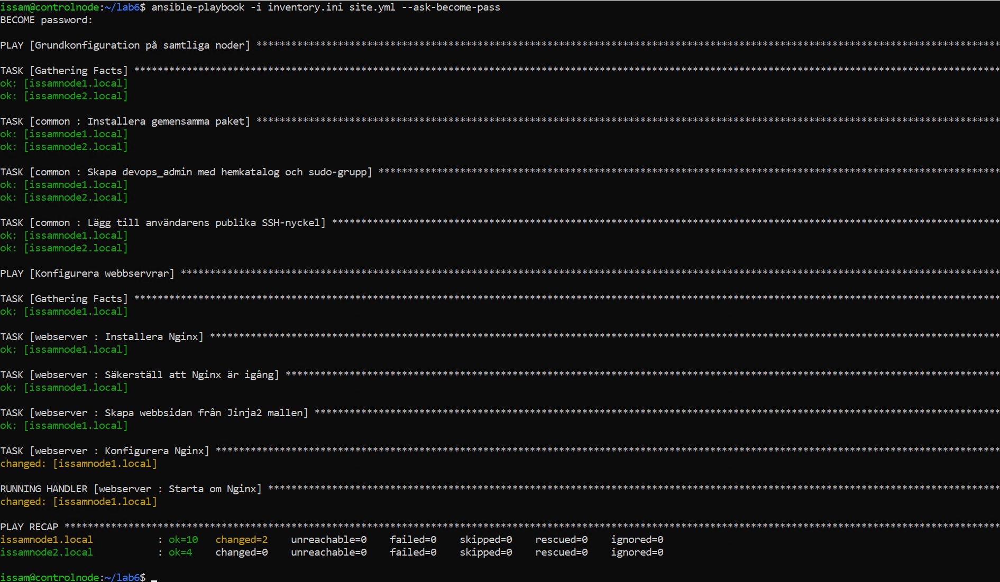
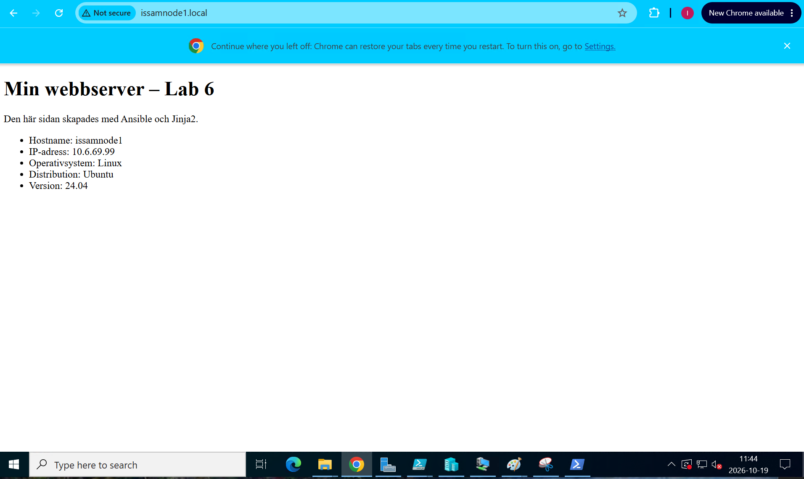
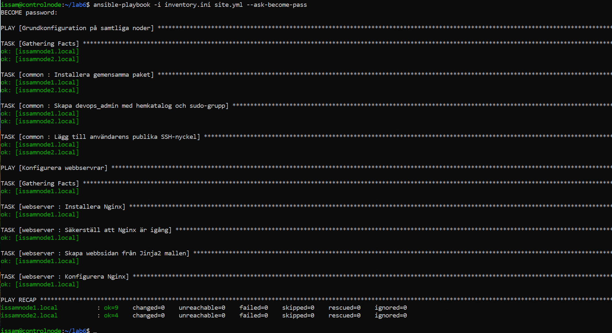

# Lab 6 – Dynamiska konfigurationsfiler med Jinja2 Templates

I den här labben byggde jag vidare på rollerna från Lab 5. Nu skulle
webbservern visa sitt eget hostname, IP-adress och operativsystem på en
HTML-sida. Uppgifterna hämtas från Ansible facts och fylls i med Jinja2.

Det nya för mig var hur en mall blir en färdig fil på noden och hur en
ändring kan kopplas till en handler. Jag använde samma controlnode och
noder som tidigare, med Nginx på issamnode1.



## Förberedelse och anslutning

För att fortsätta med samma fungerande struktur kopierade jag filerna från
Lab 5 till en egen arbetsmapp på controlnode:

```bash
mkdir -p ~/lab6
cp ~/lab5/inventory.ini ~/lab5/site.yml ~/lab6/
cp -a ~/lab5/roles ~/lab6/
cd ~/lab6
```

Inventory innehåller fortfarande issamnode1 i webservers och issamnode2
i other. Common körs på båda och webserver bara på issamnode1.

```bash
ansible all -i inventory.ini -m ping
```

Första försöket hade ett skrivfel i inventory-filens namn. Efter rättningen
svarade båda noderna med SUCCESS och pong.



## HTML-mallen index.html.j2

I [roles/webserver/templates/index.html.j2](roles/webserver/templates/index.html.j2)
skapade jag följande mall:

```html
<!DOCTYPE html>
<html lang="sv">
<head>
    <meta charset="UTF-8">
    <title>Lab 6 – Serverinformation</title>
</head>
<body>
    <h1>Min webbserver – Lab 6</h1>
    <p>Den här sidan skapades med Ansible och Jinja2.</p>

    <ul>
        <li>Hostname: {{ ansible_facts['hostname'] }}</li>
        <li>IP-adress: {{ ansible_facts['default_ipv4']['address'] }}</li>
        <li>Operativsystem: {{ ansible_facts['system'] }}</li>
        <li>Distribution: {{ ansible_facts['distribution'] }}</li>
        <li>Version: {{ ansible_facts['distribution_version'] }}</li>
    </ul>
</body>
</html>
```

Vanlig HTML följer med som den är. Uttrycken inom dubbla klammrar
ersätts med information från noden när Ansible kör uppgiften.
Hostname kommer alltså från issamnode1, även om mallfilen ligger på controlnode.
IP-adressen hämtas från default_ipv4, som beskriver nodens standardväg ut
på nätverket.

Här kunde jag koppla ihop Gathering Facts från tidigare körningar med
något som faktiskt visas på sidan. Jag behövde inte skriva in servernamnet
eller IP-adressen manuellt i HTML-filen.

## Koppla mallen till webserver-rollen

I [roles/webserver/tasks/main.yml](roles/webserver/tasks/main.yml) behöll jag
uppgifterna som installerar och startar Nginx och lade till två nya
uppgifter med ansible.builtin.template.

Den första läser index.html.j2 från rollens templates-mapp och skriver
den färdiga sidan till /var/www/html/index.html på issamnode1.
Den andra använder default.conf.j2 för Nginx-konfigurationen.

Src anger vilken mall Ansible ska läsa på controlnode. Dest anger var den
färdiga filen ska hamna på målservern. Det hjälpte mig att hålla isär var
filerna ligger och var jobbet faktiskt görs.

## Nginx-konfigurationen

Mallen [default.conf.j2](roles/webserver/templates/default.conf.j2) innehåller:

```nginx
server {
    listen 80 default_server;
    listen [::]:80 default_server;

    server_name _;
    root /var/www/html;
    index index.html;

    location / {
        try_files $uri $uri/ =404;
    }
}
```

Den skrivs till /etc/nginx/sites-available/default och säger att Nginx ska
lyssna på port 80 och använda index.html från /var/www/html som startsida.
Den här mallen har fasta värden, medan HTML-mallen använder nodens facts.

Till konfigurationsuppgiften lade jag:

```yaml
notify: Starta om Nginx
```

Notify ligger på uppgiften och meddelar handlern när konfigurationsfilen
ändras. Det är alltså ändringen i Nginx-konfigurationen som utlöser omstarten.
Själva HTML-sidan kan uppdateras utan att Nginx behöver startas om.

## Handlern

I [roles/webserver/handlers/main.yml](roles/webserver/handlers/main.yml)
skrev jag:

```yaml
---
- name: Starta om Nginx
  ansible.builtin.service:
    name: nginx
    state: restarted
# handlers file for roles/webserver
```

Namnet matchar texten efter notify. Handlern körs efter de vanliga
uppgifterna i webbserverdelen om den har blivit meddelad.
Det gör att en vanlig omkörning inte automatiskt startar om tjänsten.

## Syntaxkontroll och felsökning

Först kontrollerade jag upplägget:

```bash
ansible-playbook -i inventory.ini site.yml --syntax-check
```

Kontrollen gick igenom. Vid första körningen skapades HTML-sidan, men
konfigurationsuppgiften misslyckades. Jag hade skrivit defafult.conf.j2
i src i stället för default.conf.j2.

Efter att ha rättat namnet i rollens tasks/main.yml körde jag samma
playbook igen. Det visade att syntaxkontrollen kan godkänna YAML-koden
även om ett filnamn är fel så det var något nytt jag lärde mig. 
Själva mallfilen måste också gå att hitta när uppgiften körs.

## Körning med ändring och omstart

Från ~/lab6 på controlnode körde jag:

```bash
ansible-playbook -i inventory.ini site.yml --ask-become-pass
```

Vid lösenordsfrågan angav jag sudo-lösenordet för issam.
Efter rättningen blev resultatet:

| Nod | ok | changed | unreachable | failed |
| --- | --- | --- | --- | --- |
| issamnode1.local | 10 | 2 | 0 | 0 |
| issamnode2.local | 4 | 0 | 0 | 0 |

HTML-uppgiften visade ok eftersom sidan redan skapades under förra försöket.
Konfigurationen ändrades och meddelade handlern, som startade om Nginx.
Det var de två ändringarna som räknades i changed=2.



## Kontroll i webbläsaren

På värddatorn öppnade jag:

```text
http://issamnode1.local
```

Sidan visade följande värden:

| Uppgift | Värde |
| --- | --- |
| Hostname | issamnode1 |
| IP-adress | 10.6.69.99 |
| Operativsystem | Linux |
| Distribution | Ubuntu |
| Version | 24.04 |

Nu gick det att se resultatet av mallen. Jinja2-uttrycken hade ersatts
med nodens uppgifter och sidan gick att nå genom Nginx.



## Omkörning utan ändringar

Sedan körde jag exakt samma playbook igen:

```bash
ansible-playbook -i inventory.ini site.yml --ask-become-pass
```

| Nod | ok | changed | unreachable | failed |
| --- | --- | --- | --- | --- |
| issamnode1.local | 9 | 0 | 0 | 0 |
| issamnode2.local | 4 | 0 | 0 | 0 |

Den här gången stämde både sidan och konfigurationen redan.
Ingen ändring rapporterades och ingen handler kördes.
Issamnode1 fick därför ok=9 i stället för 10, eftersom omstarten inte behövdes.



## Min reflektion

Det som blev tydligare för mig var hur delarna från tidigare labbar nu
används tillsammans. Inventory väljer noderna, huvud-playbooken anropar
rollerna och i webserver-rollen finns uppgifterna som använder mallarna.
Facts som tidigare bara syntes i terminalen blev innehåll på min webbsida.

Samma HTML-mall kan användas på fler webbservrar och fyllas med varje
servers egna uppgifter. Då behöver jag inte skapa en separat sida och
skriva in namn och IP-adress manuellt för varje nod.

Handlern blev också lättare att förstå när jag såg båda körningarna.
När konfigurationen ändrades startades Nginx om. När inget hade ändrats
blev det ingen omstart. Det är samma tanke om idempotens som i Lab 3,
men här kunde jag även se hur den styr när en tjänst behöver startas om.

Även felsökningen gjorde att jag fick bättre koll på hur filerna hänger ihop.
När körningen misslyckades körde jag en enkel cat på rollens tasks/main.yml och såg
att filnamnet i src var felstavat. Sedan öppnade jag samma fil med nano,
rättade namnet och körde playbooken igen. Då fungerade det och handlern
startade om Nginx som den skulle.

Det är vid såna här fel jag börjar förstå mer vad jag faktiskt har skrivit.
Syntaxkontrollen hade gått igenom, men vid körningen hittade Ansible inte
mallen eftersom namnet inte stämde. Ett litet skrivfel räckte alltså för
att stoppa uppgiften. Automatiseringen gör jobbet på noderna, men jag
behöver fortfarande förstå instruktionerna och kunna ha goda grunder för att följa upp när något blir fel. Därför var det bra att öppna sidan i webbläsaren och se
att uppgifterna från noden hade kommit med.

## Filer och förutsättningar

Koden finns i [site.yml](site.yml), [inventory.ini](inventory.ini) och
[roles/](roles/). Arbetsmappen på controlnode var ~/lab6.
Common använder fortfarande ansible.posix och den publika nyckeln
~/.ssh/devops_admin.pub från Lab 4. Den privata nyckeln stannade på controlnode.
