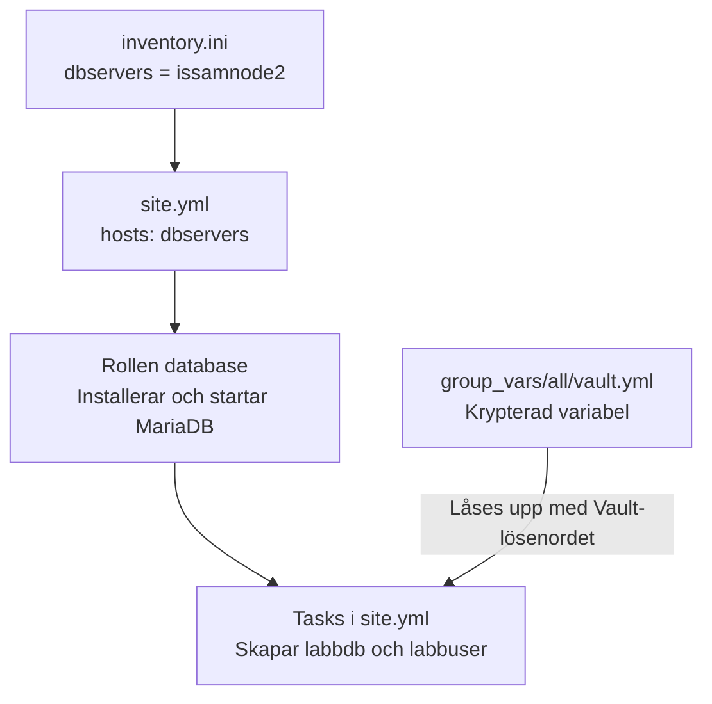
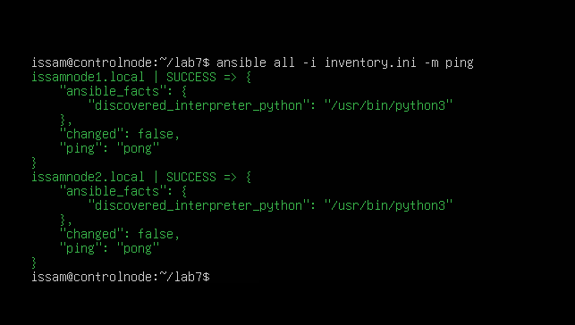
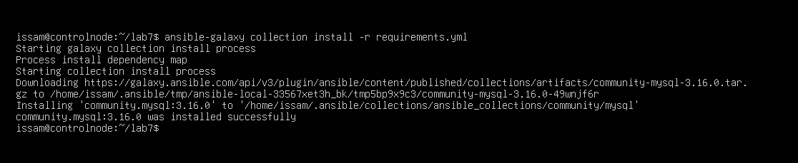
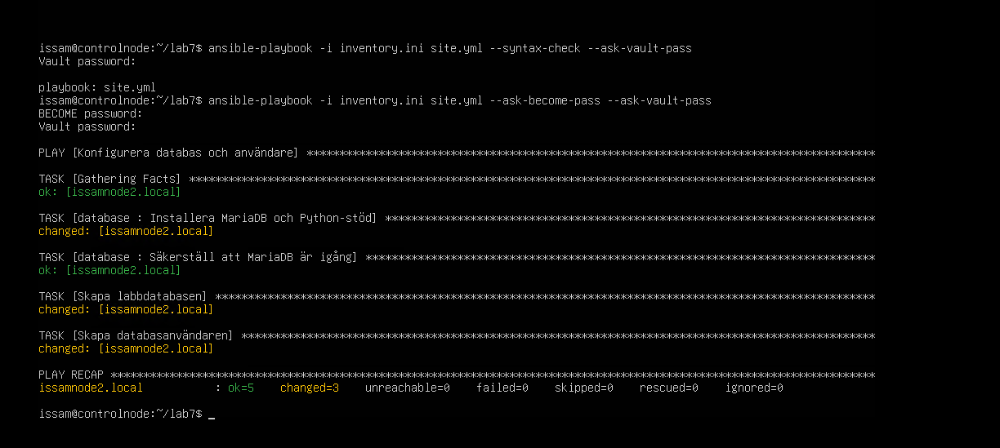
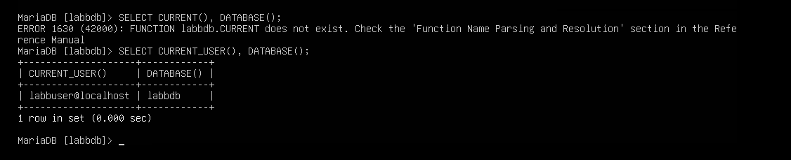
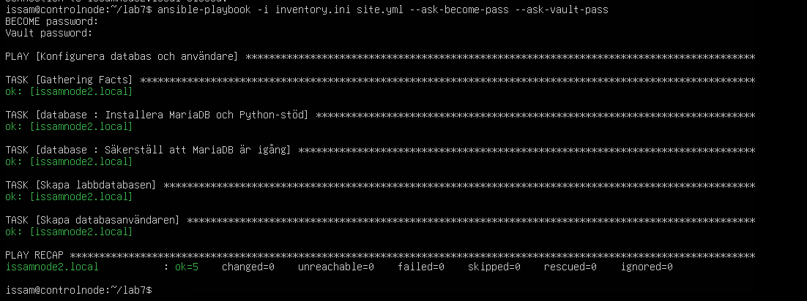

# Lab 7 – Secrets Management med Ansible Vault (VG)

I den här labben använde jag Ansible Vault för att lagra ett databaslösenord
krypterat och sedan använda det när en databasanvändare skapas. För VG-delen
valde jag MariaDB på issamnode2 och en egen roll som installerar och startar
servern. Allt kördes från controlnode.



## Förberedelse och inventory

Jag skapade en arbetsmapp för Lab 7 och kopierade min inventory från Lab 6:

```bash
mkdir -p ~/lab7
cp ~/lab6/inventory.ini ~/lab7/
cd ~/lab7
```

I inventory ändrade jag gruppen för issamnode2 till dbservers:

```ini
[webservers]
issamnode1.local ansible_user=issam

[dbservers]
issamnode2.local ansible_user=issam
```

Sedan testade jag anslutningarna:

```bash
ansible all -i inventory.ini -m ping
```

Båda noderna svarade med SUCCESS och pong. Databasinstallationen riktades
sedan till dbservers, alltså issamnode2.



## Skapa den krypterade variabelfilen

På controlnode skapade jag mapparna och Vault-filen:

```bash
mkdir -p group_vars/all
EDITOR=nano ansible-vault create group_vars/all/vault.yml
```

Jag valde ett eget Vault-lösenord och lade in uppgiftens databaslösenord
som variabeln vault_db_password. När jag sparade och stängde nano
krypterades filen. Placeringen i group_vars/all gör att Ansible läser
variabeln automatiskt vid körningen.

Vault-lösenordet används för att låsa upp filen. Databaslösenordet är det
lagrade värdet som ska sättas på labbuser. Inget av värdena återges här.

## Databasrollen

Jag skapade rollen med:

```bash
ansible-galaxy role init roles/database
```

I [roles/database/tasks/main.yml](roles/database/tasks/main.yml) skrev jag:

```yaml
---
- name: Installera MariaDB och Python-stöd
  ansible.builtin.apt:
    name:
      - mariadb-server
      - python3-pymysql
    state: present
    update_cache: true
    cache_valid_time: 3600

- name: Säkerställ att MariaDB är igång
  ansible.builtin.service:
    name: mariadb
    state: started
    enabled: true
# tasks file for roles/database
```

Rollen installerar MariaDB och Python-stödet som databasmodulerna behöver.
Den säkerställer också att tjänsten körs och startar efter en omstart.
Kopplingen till issamnode2 görs i site.yml genom hosts: dbservers.

## Installera Ansible-samlingen

För att kunna skapa databas och användare behövdes community.mysql på
controlnode. Beroendet skrev jag i [requirements.yml](requirements.yml):

```yaml
---
collections:
  - name: community.mysql
    version: '3.16.0'
```

Installationen gjordes med:

```bash
ansible-galaxy collection install -r requirements.yml
```

Installationen misslyckades först eftersom jag hade satt ett bindestreck
framför version. Efter att jag rättade indraget och tog bort bindestrecket
installerades community.mysql 3.16.0 på controlnode.



## Huvud-playbooken site.yml

Min playbook ser ut så här:

```yaml
---
- name: Konfigurera databas och användare
  hosts: dbservers
  become: true

  roles:
    - database

  tasks:
    - name: Skapa labbdatabasen
      community.mysql.mysql_db:
        name: labbdb
        state: present
        login_user: root
        login_unix_socket: /var/run/mysqld/mysqld.sock

    - name: Skapa databasanvändaren
      community.mysql.mysql_user:
        name: labbuser
        host: localhost
        password: "{{ vault_db_password }}"
        priv: 'labbdb.*:ALL'
        state: present
        login_user: root
        login_unix_socket: /var/run/mysqld/mysqld.sock
      no_log: true
```

Rollen körs först, sedan skapas labbdb och databaskontot labbuser.
Kontot får behörigheter till just labbdb. Lösenordet hämtas från
vault_db_password och no_log: true hindrar att uppgiftens detaljer skrivs ut.
Administrationen sker lokalt på noden via Unix-socket med root och sudo.

## Syntaxkontroll och körning

Först kontrollerade jag syntaxen:

```bash
ansible-playbook -i inventory.ini site.yml --syntax-check --ask-vault-pass
```

Kontrollen gick igenom. Sedan körde jag playbooken:

```bash
ansible-playbook -i inventory.ini site.yml --ask-become-pass --ask-vault-pass
```

Vid BECOME password angav jag sudo-lösenordet för issam och vid Vault
password lösenordet som låser upp Vault-filen.

| Nod | ok | changed | unreachable | failed |
| --- | --- | --- | --- | --- |
| issamnode2.local | 5 | 3 | 0 | 0 |

De tre ändringarna var installationen av paketen, den nya databasen och
databasanvändaren. Tjänsten visade redan ok efter installationen.
Issamnode1 berördes inte av körningen.



## Test av databasanvändaren

Från controlnode anslöt jag till rätt nod och startade MariaDB-klienten:

```bash
ssh -t issam@issamnode2.local 'mariadb -u labbuser -p labbdb'
```

Databaslösenordet angavs vid frågan Enter password.

Första försöket gav Permission denied eftersom jag använde det gamla
namnet node2.local. Med issamnode2.local fungerade SSH-anslutningen och
jag kunde logga in i MariaDB.

Inne i databasen körde jag:

```sql
SELECT CURRENT_USER(), DATABASE();
```

Första försöket skrev jag CURRENT() i stället för CURRENT_USER(). Det gav
ett SQL-fel. Efter rättningen blev resultatet:

| CURRENT_USER() | DATABASE() |
| --- | --- |
| labbuser@localhost | labbdb |

Det bekräftade att kontot kunde logga in med lösenordet och använda labbdb.



Avslutade anslutningen med:

```sql
exit;
```

## Kontroll av Vault-filen i råformat

För att kontrollera den lagrade filen använde jag:

```bash
head -n 5 group_vars/all/vault.yml
```

De första raderna i [vault.yml](group_vars/all/vault.yml) är:

```text
$ANSIBLE_VAULT;1.1;AES256
38393962323831393364376339613263656562343664373661303262633830356630383834313564
3565396364373765333534363532616464623434336364650a346134653934353936643761366436
66626361373038383030636238336437343339333963663134656265333832386364363038373862
3365373430333166340a356135646431303137626131333366346332356361333136626138383835
```

Filen har Vault-rubriken och krypterad data, så variabeln och lösenordet
är oläsbara i råformat. Det är denna krypterade version som jag ska pusha
till Git. Vault-lösenordet hålls utanför repot.
Körningen och inloggningstestet visar att värdet samtidigt kunde användas
för att skapa ett fungerande databaskonto.

## Omkörning utan ändringar

Efter inloggningstestet körde jag samma playbook igen:

```bash
ansible-playbook -i inventory.ini site.yml --ask-become-pass --ask-vault-pass
```

| Nod | ok | changed | unreachable | failed |
| --- | --- | --- | --- | --- |
| issamnode2.local | 5 | 0 | 0 | 0 |

Allt hade redan rätt tillstånd. Omkörningen gav changed=0 och failed=0,
vilket bekräftade att inga nya ändringar behövdes.



## Min reflektion

I början blev det lite rörigt med alla filer och de olika lösenorden.
När jag gick tillbaka och läste rad för rad började det ge mer mening.
Det hjälpte att stanna upp och kolla var kopplingen till issamnode2 fanns.
Jag ville förstå vad raderna påverkade innan jag körde vidare. Jag tycker
att det är viktigt att förstå processen
och inte bara glädjas av att allt går igenom. När man tittar strukturerat på
samtliga roller, tasks, playbooks, ändringar i inventories då ser man klart och tydligare att det finns en tydlig struktur kring arbetet i Ansible.

Vid inloggningen började jag fundera på lösenordet, men jag hade skrivit
fel servernamn och kom inte ens fram till databasen. Det blev en påminnelse
om att läsa vilken del som faktiskt ger felet. Samma sak med SQL-kommandot,
där jag fick rätta CURRENT() till CURRENT_USER().

Nyttan med Vault blev tydlig när kontot fungerade samtidigt som filen i
repot fortfarande var krypterad. Det är vid de här uppgifterna jag börjar
se hur allt hänger ihop. Jag vill både se att körningen går igenom och
kontrollera resultatet, som här genom att faktiskt logga in som labbuser.

## Filer och förutsättningar

Arbetsmappen på controlnode var ~/lab7. Koden finns i [site.yml](site.yml),
[inventory.ini](inventory.ini), [requirements.yml](requirements.yml) och
[roles/database/](roles/database/). Den krypterade variabelfilen finns i
[group_vars/all/vault.yml](group_vars/all/vault.yml).

Samlingen installeras från requirements.yml innan playbooken körs.
Vault-lösenordet anges vid körningen och finns inte i rapporten.
Repots [.gitignore](../.gitignore) är förberedd för att hålla lösenordsfiler,
privata SSH-nycklar och tillfälliga filer utanför Git.
