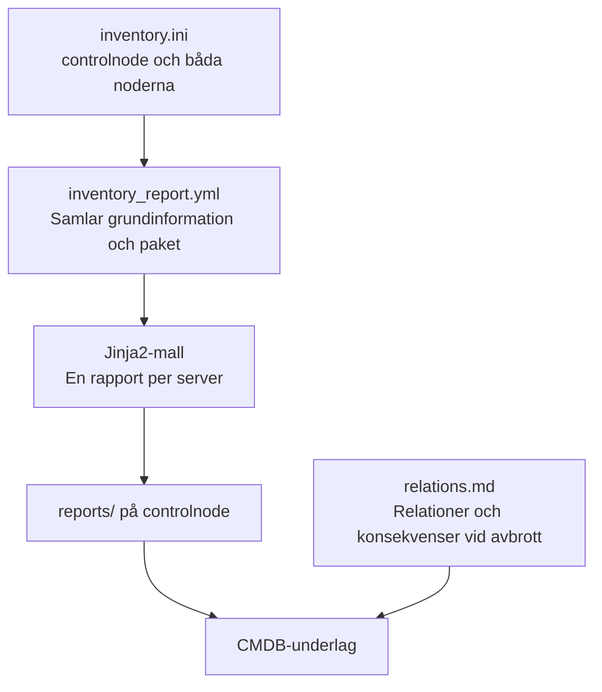
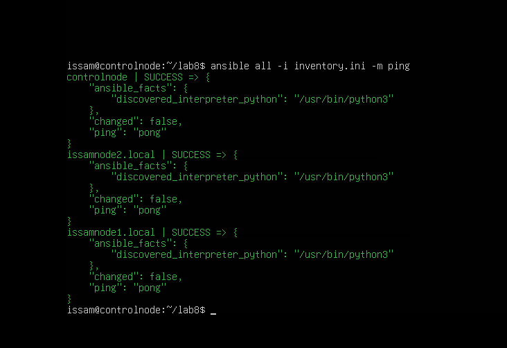
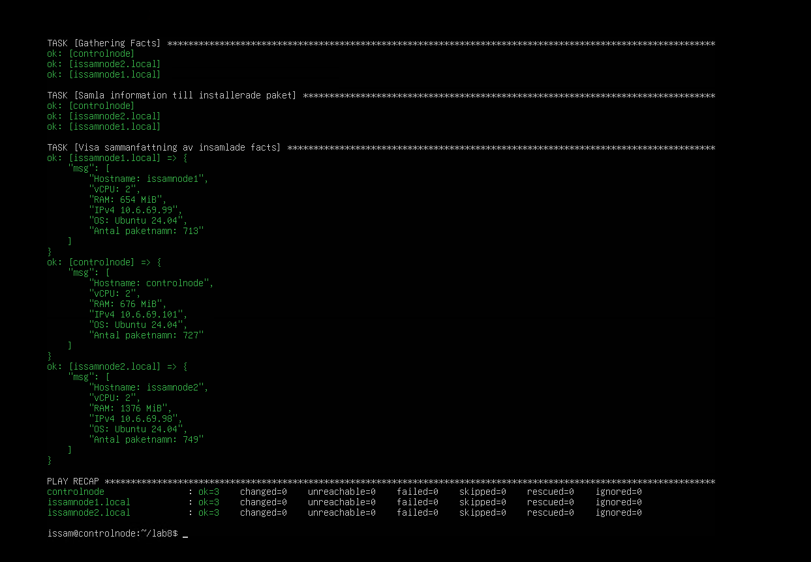
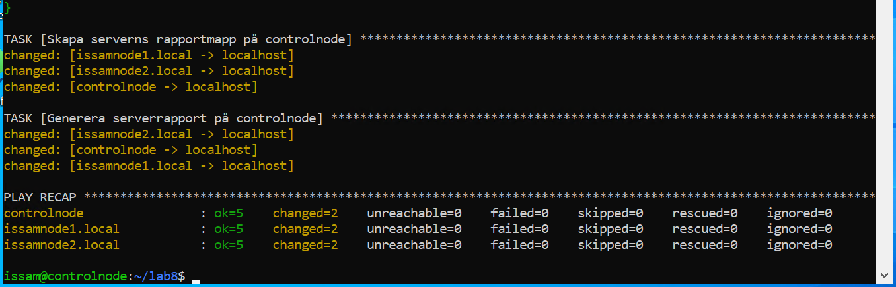
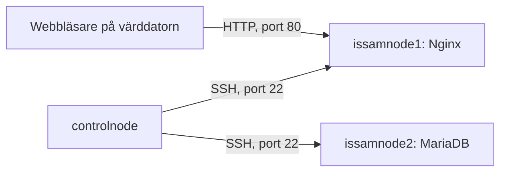

# Lab 8 – CMDB och Configuration Items (VG)

I detta labbandet använde jag Ansible för att få en samlad bild av min labbmiljö.
Tidigare har fokus varit att installera och konfigurera tjänster. Nu samlade
jag i stället information om det som redan finns på servrarna och skapade en
Markdown-rapport för varje server.

För VG-delen dokumenterade jag även hur servrarna hänger ihop och vad som
påverkas om någon av dem slutar fungera. Allt kördes från controlnode.



## Inventory och anslutningstest

Utgick från min inventory i Lab 7 och arbetade i ~/lab8 på controlnode.
Den här gången lade jag även till controlnode i inventory för att få med
alla tre servrarna i underlaget.

```ini
[webservers]
issamnode1.local ansible_user=issam

[dbservers]
issamnode2.local ansible_user=issam

[control]
controlnode ansible_connection=local
```

Med ansible_connection=local körs uppgifterna för controlnode direkt där.
De andra noderna nås via SSH. Playbooken använder hosts: all och samlar därför
information från samtliga tre, oavsett vilken grupp de tillhör.

Kontrollerade kontakten innan jag gick vidare:

```bash
ansible all -i inventory.ini -m ping
```

Alla tre svarade med SUCCESS och pong.



## Insamling av facts

Började med att samla grundinformation och skriva ut en sammanfattning i
terminalen. Med gather_facts: true fick jag bland annat hostname, CPU, RAM,
IP-adresser och OS. Installerade paket samlades in separat med
ansible.builtin.package_facts.

Grundinformationen och paketuppgifterna sparas i ansible_facts och används
sedan i sammanfattningen och rapportmallen.

Den första körningen gav ok=3, changed=0 och failed=0 på alla servrar.
Kontrollerade namn, IP-adresser och paketantal innan jag gick vidare.



## Playbooken

När insamlingen fungerade lade jag till uppgifterna som skapar rapportmapparna
och rapportfilerna. Den färdiga [inventory_report.yml](inventory_report.yml)
ser ut så här:

```yaml
---
- name: Samla information till CMDB-underlag
  hosts: all
  gather_facts: true

  tasks:
    - name: Samla information till installerade paket
      ansible.builtin.package_facts:
        manager: auto


    - name: Visa sammanfattning av insamlade facts
      ansible.builtin.debug:
        msg:
          - "Hostname: {{ ansible_facts['hostname'] }}"
          - "vCPU: {{ ansible_facts['processor_vcpus'] }}"
          - "RAM: {{ ansible_facts['memtotal_mb'] }} MiB"
          - "IPv4 {{ ansible_facts['all_ipv4_addresses'] | join(', ') }}"
          - "OS: {{ ansible_facts['distribution'] }} {{ ansible_facts['distribution_version'] }}"
          - "Antal paketnamn: {{ ansible_facts['packages'] | length }}"

    - name: Skapa serverns rapportmapp på controlnode
      ansible.builtin.file:
        path: "{{ playbook_dir }}/reports/{{ inventory_hostname }}"
        state: directory
        mode: '0755'
      delegate_to: localhost

    - name: Generera serverrapport på controlnode
      ansible.builtin.template:
        src: templates/inventory_report.md.j2
        dest: "{{ playbook_dir }}/reports/{{ inventory_hostname }}/inventory_report.md"
        mode: '0644'
      delegate_to: localhost
```

Med delegate_to: localhost sparas rapporterna på controlnode, med information
från respektive server. Inventory_hostname ger varje server en egen mapp under
reports/ så att rapporterna inte skriver över varandra.

## Jinja2-mallen

I [templates/inventory_report.md.j2](templates/inventory_report.md.j2) skapade
jag en tabell med serverns grundinformation och en tabell med installerade
paket och deras versioner.

Paketlistan byggs med följande del av mallen:

```jinja2


| {{ package_name }} | {{ package['version'] }} |


```

Looparna skriver paketnamn och versionsposter som tabellrader i sorterad
ordning. Då får jag en fullständig paketlista att kontrollera, utöver antalet
paketnamn i sammanfattningen.

## Körning och genererade rapporter

Körde den färdiga playbooken från ~/lab8:

```bash
ansible-playbook -i inventory.ini inventory_report.yml
```

| Server | ok | changed | unreachable | failed |
| --- | --- | --- | --- | --- |
| controlnode | 5 | 2 | 0 | 0 |
| issamnode1.local | 5 | 2 | 0 | 0 |
| issamnode2.local | 5 | 2 | 0 | 0 |

De två ändringarna per server var att rapportmappen och rapportfilen skapades.
I utskriften syns också -> localhost på dessa uppgifter, vilket visar att de
kördes på controlnode.



Kontrollerade sedan början av de genererade filerna:

```bash
head -n 16 reports/*/inventory_report.md
```

Resultatet i de sparade rapporterna blev:

| Serverrapport | IPv4 | vCPU | RAM | Antal paketnamn |
| --- | --- | --- | --- | --- |
| [controlnode](reports/controlnode/inventory_report.md) | 10.6.69.101 | 2 | 674 MiB | 727 |
| [issamnode1](reports/issamnode1.local/inventory_report.md) | 10.6.69.99 | 2 | 640 MiB | 713 |
| [issamnode2](reports/issamnode2.local/inventory_report.md) | 10.6.69.98 | 2 | 1396 MiB | 749 |

Samtliga visar Ubuntu 24.04, arkitekturen x86_64 och kärnan
6.8.0-146-generic. RAM-värdena i tabellen kommer från de sparade rapporterna.
Skärmbilden med debug-utskriften visar en tidigare insamling och har lite
andra RAM-värden.

För att kontrollera paketlistorna sökte jag efter program som jag redan visste
fanns på respektive nod:

```bash
grep -H -E '^\| (nginx|mariadb-server) \|' reports/*/inventory_report.md
```

| Server | Paket | Version i rapporten |
| --- | --- | --- |
| issamnode1 | nginx | 1.24.0-2ubuntu7.18 |
| issamnode2 | mariadb-server | 1:10.11.14-0ubuntu0.24.04.1 |

Det bekräftade att både paketnamn och versioner kom med på rätt server.
Rapporterna visar informationen vid insamlingen och behöver genereras på nytt
för att fånga senare ändringar i miljön.

## VG – relationer och beroenden

I [relations.md](relations.md) dokumenterade jag anslutningarnas riktning
och vad ett avbrott skulle påverka. Det utgår från hur miljön är konfigurerad;
relationerna upptäcks inte automatiskt av faktainsamlingen.



| Källa | Mål | Användning |
| --- | --- | --- |
| controlnode | issamnode1 | Administration och insamling av facts via SSH, port 22. |
| controlnode | issamnode2 | Administration och insamling av facts via SSH, port 22. |
| Webbläsaren på värddatorn | issamnode1 | Hämtar webbsidan från Nginx via HTTP, port 80. |

Controlnode används för administrationen. Nginx och MariaDB kör sedan på sina
egna noder och behöver inte controlnode för varje anrop till tjänsterna.

### Konsekvenser vid avbrott

| Server som slutar fungera | Påverkan på resten av miljön |
| --- | --- |
| controlnode | Nya Ansible-körningar och rapportinsamling kan inte göras därifrån. Nginx och MariaDB kan fortsätta fungera på sina noder. |
| issamnode1 | Webbsidan blir otillgänglig. MariaDB på issamnode2 kan fortsätta fungera. |
| issamnode2 | Databasen blir otillgänglig. Den nuvarande statiska webbsidan på issamnode1 kan fortsätta fungera eftersom den inte använder databasen. |

Webbservern och databasen finns alltså på varsin nod, men någon
applikationsanslutning mellan dem finns inte ännu. Om jag senare kopplar en
webbapplikation till MariaDB får jag ett beroende i riktningen
webbapplikation → databas. Då kan ett databasavbrott påverka de funktioner som
behöver databasen, även om Nginx fortfarande körs.

## Koppling till CMDB

I mitt underlag dokumenteras varje server som en Configuration Item, CI,
med egenskaper som CPU, RAM, IP-adresser, OS och installerad programvara.
En CMDB samlar information om dessa objekt och hur de hänger ihop.

Serverrapporterna beskriver vad som finns på varje server. Relationsfilen
kompletterar med anslutningar, beroenden och vad ett avbrott kan påverka.
Tillsammans blir de ett CMDB-underlag som går att använda när jag behöver
förstå miljön eller bedöma en förändring.

## Min reflektion

Det som fastnade mest i den här labben var hur informationen kan samlas in
och sedan återanvändas i en mall. Behövde stanna upp lite kring ansible_facts
och vad de olika delarna faktiskt gör. När jag kopplade det till en dictionary
och läste raderna var för sig blev det mycket lättare att följa.
Package_facts samlar paketinformationen och template använder den för att
skapa filen. Det hjälpte att få isär de stegen.

Även kopplingen mellan inventory och playbooken blev tydligare under
genomgången. Om playbooken väljer en grupp följer servrarna i den gruppen med.
Jag behöver alltså inte lägga in varje server igen i själva playbooken.
Det gör det lättare att förstå hur samma uppgifter kan användas på fler noder.

VG-delen fick mig att tänka ett steg längre än vilka program som är
installerade. Att jag har en webbserver och en databas betyder inte automatiskt
att de använder varandra. Här behövde jag utgå från hur det faktiskt ser ut
just nu och sedan resonera kring vad som skulle förändras med en
applikationsanslutning. Det är vid sådana delar man börjar se nyttan av att
ha miljön dokumenterad, både vad som finns och hur det hänger ihop.

## Filer och förutsättningar

Körningen gjordes från ~/lab8 på controlnode med anslutningarna från tidigare
labbar. Mappen innehåller [playbooken](inventory_report.yml),
[inventory](inventory.ini), [mallen](templates/inventory_report.md.j2),
[serverrapporterna](reports/) och [relationsfilen](relations.md).
