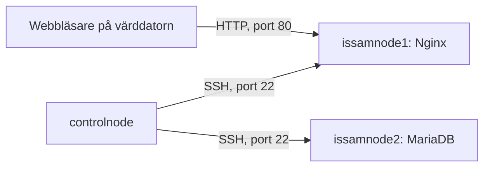

# Relationer och beroenden i labbmiljön

## Nuvarande relationer

Här har jag samlat hur anslutningarna ser ut i labbmiljön. Pilarna visar vem som ansluter till vem. Controlnode administrerar båda noderna via SSH, medan webbläsaren på värddatorn ansluter till Nginx via HTTP.

| Källa | Mål | Användning |
| --- | --- | --- |
| controlnode | issamnode1 | Ansible samlar facts och konfigurerar webbservern via SSH. |
| controlnode | issamnode2 | Ansible samlar facts och konfigurerar databasservern via SSH. |
| Webbläsaren på värddatorn | issamnode1 | Hämtar webbsidan från Nginx via HTTP. |

## Konsekvenser vid avbrott

Att controlnode administrerar servrarna betyder inte att den behöver vara igång för att tjänsterna ska fortsätta fungera. Därför behöver konsekvenserna bedömas utifrån vilken server som försvinner och vad den används till.

| Server som slutar fungera | Konsekvens |
| --- | --- |
| controlnode | Ansible-körningar och ny rapportinsamling kan inte göras därifrån. Nginx och MariaDB kan fortsätta köra på sina noder. |
| issamnode1 | Webbsidan blir otillgänglig. MariaDB på issamnode2 kan fortsätta fungera. |
| issamnode2 | Databasen blir otillgänglig. Den nuvarande statiska webbsidan på issamnode1 kan fortsätta fungera eftersom den inte använder databasen. |

## Webbserver och databas

Issamnode1 kör webbservern och issamnode2 kör databasen, men någon applikation som kopplar ihop dem finns inte ännu. Webbsidan är fortfarande statisk och hämtar inget från MariaDB. Därför skulle ett avbrott på databasservern inte påverka sidan som den fungerar idag.

Om en webbapplikation senare börjar använda databasen förändras beroendet. Då får vi en anslutning från webbapplikationen till databasen. Ett databasavbrott kan då påverka funktionerna i applikationen, även om själva webbservern fortfarande är igång.

## Koppling till CMDB

Det som blev tydligare här är att serverinformationen bara visar en del av miljön.
CPU, RAM och installerade paket berättar vad som finns på servrarna, men inte hur de hänger ihop.

Med relationerna och konsekvenserna vid avbrott går det också att resonera kring vad som påverkas när en server slutar fungera.
Tillsammans med de genererade rapporterna blir det ett CMDB-underlag som hjälper mig att förstå miljön bättre.
