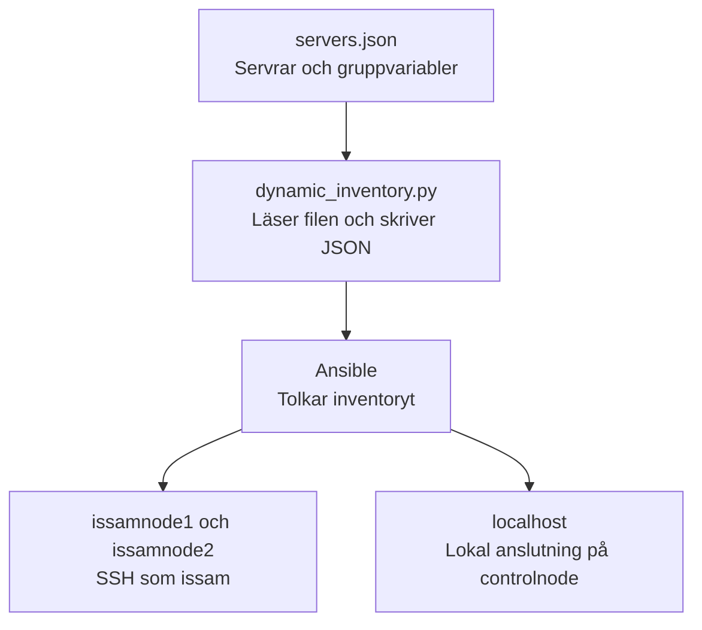
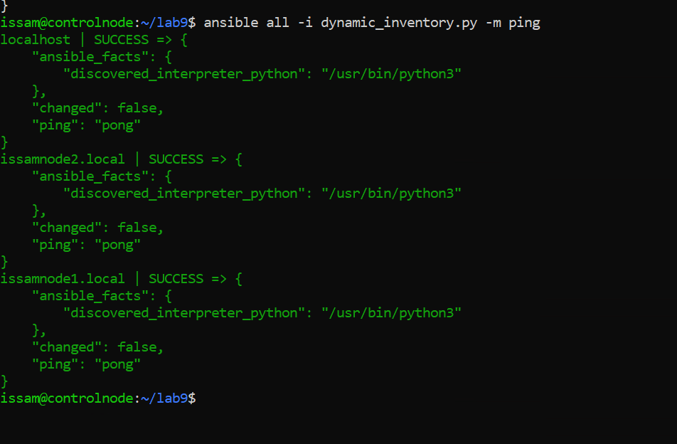
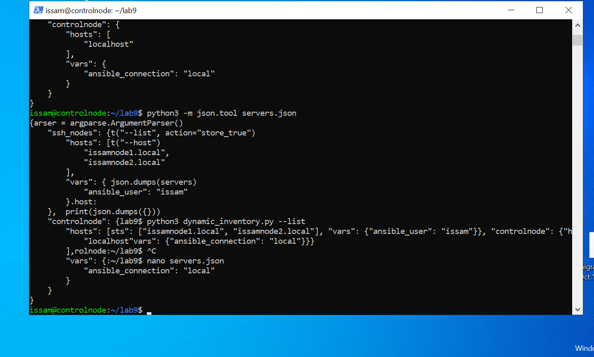
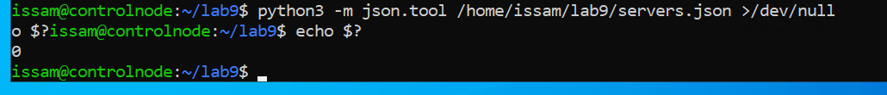
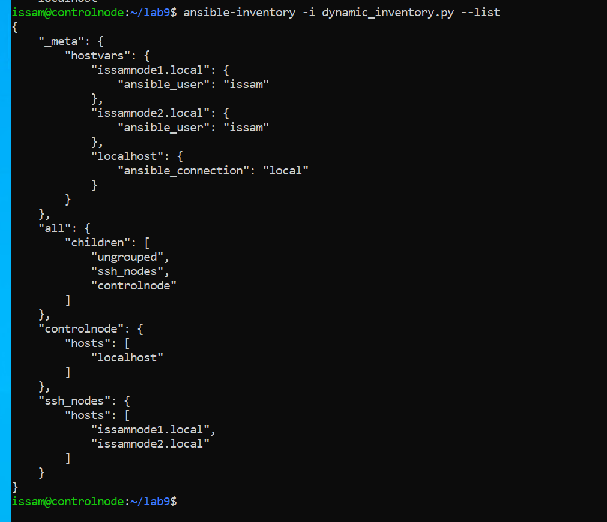
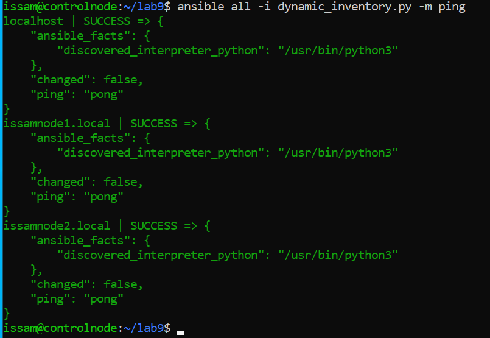

# Lab 9 – Dynamiska inventories med Python

I det här labbandet byggde jag ett eget inventoryskript i Python. Tidigare
har jag angett servrarna i inventory.ini. Nu använder Ansible ett körbart
skript som läser serveruppgifterna från en separat JSON-fil och lämnar
informationen vidare som JSON.

Inventoryskriptet körs på controlnode. Därifrån testade jag anslutningen till
båda noderna och den lokala anslutningen till controlnode.



## Upplägg och servergrupper

Arbetade i ~/lab9 på controlnode. Började med att leta upp min fungerande
inventory från tidigare labbar för att kontrollera servernamnen. Använde
Linuxgrunderna för att söka i mapparna och jämförde med det som redan fungerade.

I skriptet delade jag upp värdarna i två grupper:

| Grupp | Värdar | Anslutning |
| --- | --- | --- |
| ssh_nodes | issamnode1.local och issamnode2.local | SSH med ansible_user satt till issam. |
| controlnode | localhost | Lokal körning med ansible_connection satt till local. |

Gruppens hosts innehåller värdlistan och vars innehåller de gemensamma
variablerna. Localhost är här inventorynamnet för controlnodes lokala körning.

## Bygga skriptet stegvis

Började med serveruppgifterna direkt i en Python-dictionary. Först fick jag
ordning på grupperna, sedan på JSON-utskriften och argumenten. Utgick från
[Ansibles format för inventoryskript](https://docs.ansible.com/projects/ansible/latest/dev_guide/developing_inventory.html#inventory-script-conventions)
och [Pythons exempel för argparse](https://docs.python.org/3/howto/argparse.html#introducing-optional-arguments).

För att hitta funktionerna för JSON och filinläsning använde jag modulhjälpen:

```bash
python3 -m pydoc json
python3 -m pydoc open
```

Under arbetet fick jag rätta kommatecken, kolon och indrag. Hade även skrivit
server där dictionaryn hette servers. Det hjälpte att granska en liten del i
taget och hålla isär själva serverinformationen och objektet som tolkar
kommandoradsargumenten.

Skriptet fick följande beteende, som jag testade innan jag gick vidare:

| Anrop | Resultat |
| --- | --- |
| Med --list | Hela inventoryt skrivs ut som JSON. |
| Med --host och ett värdnamn | Ett tomt JSON-objekt, {}, skrivs ut. |
| Utan argument | Ingen inventoryutskrift. |

Anslutningsvariablerna ligger på gruppnivå. Jag har inga värdspecifika
variabler att returnera genom --host i den här versionen.

Lade en shebang för Python 3 överst och gav filen körbehörighet:

```bash
chmod +x dynamic_inventory.py
/home/issam/lab9/dynamic_inventory.py --list
```

Direktanropet gav JSON-utskriften. Testade också den andra grenen:

```bash
python3 dynamic_inventory.py --host issamnode1.local
```

Den returnerade {} som väntat.

## Första anslutningstestet

När skriptet kunde användas som inventory testade jag noderna med:

```bash
ansible all -i dynamic_inventory.py -m ping
```

Alla tre svarade med SUCCESS och pong. Då hade jag verifierat skriptets
inventoryformat och anslutningar innan jag flyttade ut datan till en egen fil.



## Serveruppgifter i en separat JSON-fil

Nästa steg var att flytta datan till [servers.json](servers.json). Utgick
från skriptets fungerande JSON-utskrift och sparade den i filen. Innehållet
ser ut så här, med indrag för läsbarhet:

```json
{
    "ssh_nodes": {
        "hosts": [
            "issamnode1.local",
            "issamnode2.local"
        ],
        "vars": {
            "ansible_user": "issam"
        }
    },
    "controlnode": {
        "hosts": [
            "localhost"
        ],
        "vars": {
            "ansible_connection": "local"
        }
    }
}
```

Kontrollerade filen med:

```bash
python3 -m json.tool servers.json
```




Gjorde kontroll utan att skriva ut innehållet genom att skicka innehållet till "svarta hålet" >/dev/null och läste avslutningskoden som blev 0:

```bash
python3 -m json.tool /home/issam/lab9/servers.json >/dev/null
echo $?
```

Resultatet blev 0, vilket bekräftade att JSON-filen var giltig.



Efter kontrollen ersatte jag dictionaryblocket i Pythonfilen med inläsning
från servers.json. Serverlistan och gruppvariablerna ligger nu i datafilen,
medan skriptet sköter inläsningen och svaren till Ansible.

Datakällan i den här labben är en lokal fil som läses vid varje körning.
Ett API kan senare användas som källa, men den lösning jag har testat här är
filbaserad och serverlistan underhålls i servers.json.

## Det färdiga inventoryskriptet

Koden i [dynamic_inventory.py](dynamic_inventory.py) är:

```python
#!/usr/bin/env python3
import json
import argparse
with open('/home/issam/lab9/servers.json', 'r') as file:
	servers = json.load(file)

parser = argparse.ArgumentParser()
parser.add_argument("--list", action="store_true")
parser.add_argument("--host")
args = parser.parse_args()
if args.list:

	servers = json.dumps(servers)
	print(servers)
elif args.host:
	print(json.dumps({}))
```

Med json.load läses filen till ett Python-objekt. Vid --list omvandlas det
tillbaka till en JSON-sträng med json.dumps och skrivs ut med print, så att
Ansible kan läsa svaret. With-blocket stänger datafilen efter inläsningen.

## Verifiera inventoryt med Ansible

Efter ändringen kontrollerade jag den färdiga versionen med:

```bash
ansible-inventory -i dynamic_inventory.py --list
```

Råkade först använda ansible all med --list och fick då en värdlista.
För JSON-strukturen behövde jag använda ansible-inventory.

I resultatet fanns grupperna ssh_nodes och controlnode samt alla tre värdar.
Under _meta.hostvars visade Ansible följande anslutningsvariabler:

| Värd | Variabel | Värde |
| --- | --- | --- |
| issamnode1.local | ansible_user | issam |
| issamnode2.local | ansible_user | issam |
| localhost | ansible_connection | local |

Det visade att gruppvariablerna följde med till rätt värdar även efter
att jag flyttade serveruppgifterna till JSON-filen.



## Slutligt pingtest

Körde om anslutningstestet efter ändringen av datakällan:

```bash
ansible all -i dynamic_inventory.py -m ping
```

| Värd | Status | Svar | changed |
| --- | --- | --- | --- |
| localhost | SUCCESS | pong | false |
| issamnode1.local | SUCCESS | pong | false |
| issamnode2.local | SUCCESS | pong | false |

Samtliga svarade. Därmed fungerade kedjan från JSON-filen, genom skriptet
och Ansibles inventorytolkning, till körningen av ping-modulen på värdarna.



## Min reflektion

I den här labben ville jag ta mer ansvar för själva kodandet och använda
vägledning när jag fastnade. Började med en egen skiss och byggde vidare i
små delar. Fick slå upp funktionerna och sedan försöka använda dem i min kod.
Det blev också en hel del Python här, framför allt dictionaries, filinläsning
och argumenthantering.

Behövde stanna upp kring vad de olika objekten faktiskt innehåller. Variabeln servers
innehåller datan jag vill lämna vidare, medan parsern håller reda på vilka argument
programmet ska förstå. När jag såg den uppdelningen blev det lättare att
följa varför argumenthanteringen skulle ligga före utskriften och varför
print skulle ligga inne i villkoret.

Att gå tillbaka till tidigare filer och leta upp namnen själv var också
nyttigt. Kunde använda Linuxgrunderna och jämföra med en fungerande
konfiguration. Samma sak vid kontrollerna, där jag fick skilja på att lista
värdar och att visa hela inventorystrukturen.

Det jag tar med mig är hur delarna hänger ihop. Serveruppgifterna ligger i
en egen fil, Python läser dem och Ansible använder resultatet för att nå
noderna. Jag vill kunna följa det flödet och förstå var jag ska börja leta
när något blir fel. Kommandon och parametrar går att slå upp, men jag behöver
förstå vad de ska åstadkomma för att kunna använda dem rätt.

Det här labbet tog allra mest tid utav alla labbar, samtliga källor för skript, kod, argument och json moduler togs ifrån nätet w3school, pythons hemsida och ansible docs. Det var extremt lärorikt och väldigt pillrigt hehe.

## Filer och förutsättningar

Källkoden finns i [dynamic_inventory.py](dynamic_inventory.py) och datakällan
i [servers.json](servers.json). Skriptet använder Pythons standardbibliotek.
SSH-åtkomsten till noderna fanns från tidigare labbar.

Körningen gjordes från /home/issam/lab9 på controlnode. Den inlämnade
Pythonfilen läser data från den fasta sökvägen /home/issam/lab9/servers.json.
Vid återanvändning på en annan plats behöver den sökvägen anpassas eller
filerna placeras som vid labbkörningen.
